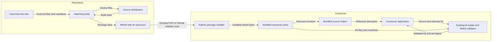

# Bundled kit distribution

## Architecture

The Python distribution contains all first-party kit releases.
`kits/` remains the canonical source tree.
Hatchling copies this tree to `raes_env_packs/resources/kits/` in the wheel.
The source distribution contains the original `kits/` tree.
The existing release workflow builds the wheel from the source distribution.

`bundled_kit_source()` returns an ordinary `KitSource` descriptor.
Its root is the installed package's `resources/` directory.
Its source id is `openrae-env-packs`.
Its source revision is `raes-env-packs==<installed-version>`.
Individual kit versions remain independent of the Python distribution version.

The helper resolves the directory through the standard package-resource API and
requires a normal filesystem installation. If the resource is not
filesystem-backed or the bundled directory is absent, the helper raises
`KitError`. It does not extract to temporary storage, search the current
directory, or fall back to a checkout.
An editable installation can use an explicit `KitSource` for its checkout.

## Data flows and trust boundaries

The wheel crosses the publication boundary through the established release workflow.
The helper describes a source; it does not admit the source as trusted.
The existing loader validates the exact inventory, SDL parent, checksums, sizes, and RAES set digest.
It rejects unsafe filesystem members and changed bytes.
The helper does not acquire content or execute kit files.

## Security and verification

The protected assets are kit bytes, kit identity, and materialization provenance.
Omitted files or changed bytes can invalidate a released kit.
Distribution tests compare the complete packaged inventory with the canonical tree.
An installed-wheel test validates every kit through the existing loader.
A changed payload must fail validation.
The public-distribution gate also refuses any canonical release whose kit
manifest is not cleared for redistribution. Restricted remains a valid schema
value for other catalogs; it is not valid input to this public artifact.
The gate rejects files outside validated kit releases.

A checkout fallback could misidentify mutable source bytes as released content.
The helper therefore fails when installed kit resources are absent.
Tests check this failure without access to a repository fallback.
The package version records source provenance; it does not prove authenticity.
Existing release attestations remain the authenticity evidence.
Consumers remain responsible for package admission and filesystem integrity after installation.

## Configuration and decisions

`pyproject.toml` remains the sole packaging configuration.
Its existing wheel inclusion table and source distribution list carry the kit tree.
No new build hook, network client, registry, or release workflow is required.
The existing loader remains the executable integrity policy.
Existing filesystem checks need no second implementation.
ADR 0041 extends ADR 0036 with package distribution and the additional source revision form.
No deployment configuration changes because kits remain authoring-time content.

## References

- [Hatch build configuration](https://hatch.pypa.io/latest/config/build/): forced inclusion and source distribution file selection; Hatchling 1.32.4.
- [Python packaging tutorial](https://packaging.python.org/en/latest/tutorials/packaging-projects/): source distribution and wheel build pattern.
- [ASD-STE100 Issue 9](https://www.asd-ste100.org/assets/files/ASD-STE100_ISSUE9.pdf): writing rules, section 4.
- ADR 0012 defines the existing RAES content identity boundary.
- ADR 0015 defines distribution build provenance.

The document review uses short sentences and consistent technical names.
Architecture, security, data flow, and decision content remain separate from implementation tasks.
