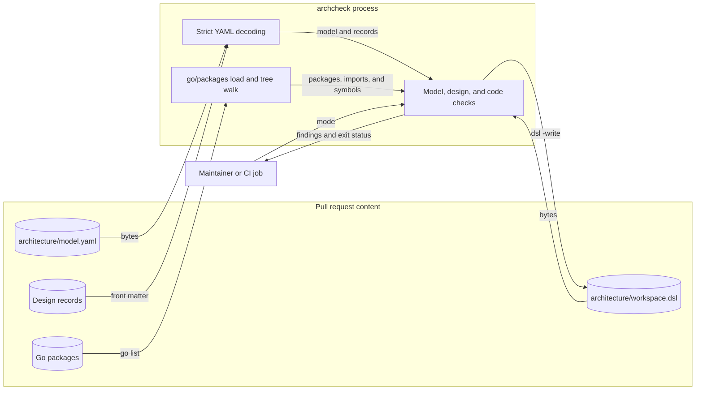

# Design 0001: Architecture model, checker, and design step

Issue: #555 (chunk 04 of the Go port).

## Problem

The Python implementation has no architecture check. The review found 44
references from 10 modules to 24 private names of other modules, and an import
that changes `sys.path` for the whole process. The ADRs state structural rules,
such as "every pack read uses the descriptor-anchored boundary", but no tool
checks them. The Go code must not repeat these failure modes.

## Design

### The model

`architecture/model.yaml` is the one architecture model of the repository. It
names:

- the system, its people, and the external systems (the C4 context);
- the containers: the commands, the Go library, and the repository tools;
- the components, the container of each component, and the Go packages that
  each component owns;
- the components that each component may depend on;
- the external modules that each component may import, and the modules that
  any test file may import;
- the rules: forbidden imports and forbidden symbols, with the scope of each
  rule and a fix-it message.

Each package names its owner explicitly. A pattern cannot own a package, so a
new package needs a model change.

### The checker

`tools/archcheck` loads the model, the design records, and every package of
the module with `golang.org/x/tools/go/packages`. It has two modes:

- `archcheck design` checks the model and the design records. It does not read
  the code, so it passes before the code exists.
- `archcheck check` adds the code checks and the check of the generated C4
  view.

The code checks report these findings:

- a package that no component owns;
- a package that the model names but the code does not have;
- an import of another component that the model does not permit;
- an import of an external module that the component may not use;
- an import or a symbol that a rule forbids;
- a path that matches `./...` but that the checker cannot read: a Go file
  that build constraints exclude or that uses cgo, or a directory that it
  cannot list.

`go/packages` reads one build configuration, and it does not return a
directory whose files the build constraints all exclude. So the checker also
walks the module tree with the skip rules of the go command. Each Go file that
it finds must be in the loaded packages, or the check fails.

Each finding gives the file and line, the rule, and a fix-it message. The
checker reports every finding and exits with status 1 when there is one. It has
no baseline: the Go code starts with no findings.

### Design records

A design record is a Markdown file in `docs/development/designs/`, named
`NNNN-slug.md`. Its front matter lists the changes of the design to the
structure of the model: containers, components, packages, dependencies,
modules, test modules, and rule identifiers. Each list has `add` and `remove`
entries.

The checker applies the records in number order to an empty model. The result
must be equal to the structure of `architecture/model.yaml`. So the model
cannot change without a design record, and a design record cannot declare a
change that the model does not have.

The descriptions and the rule bodies are only in the model, so the records do
not copy them.

### The C4 view

The checker renders the model as a Structurizr DSL workspace with the
`text/template` package. `archcheck check` fails when
`architecture/workspace.dsl` differs from the rendered view. `make go-arch-dsl`
writes the file again.

### Rules moved from golangci-lint

Chunk 03 put the silent-library rules in `.golangci.yml`. They are rules of the
architecture, so this design moves them to the model. `.golangci.yml` keeps the
rules that apply to all code: no assertion libraries, no `reflect.DeepEqual`,
no `math/rand`, no `io/ioutil`, no `github.com/pkg/errors`, and no
`golang.org/x/exp` copies of standard packages.

## Systems security engineering

The checker is a merge gate. A pull request can change each of its inputs: the
model, the design records, the Go code, and the C4 view.

| Asset | Protection need |
| --- | --- |
| Architecture model and design records | Integrity |
| Merge decision (the exit status of the check) | Integrity |

| Threat | Boundary | Control | Verification |
| --- | --- | --- | --- |
| A change puts code where the checker does not read it, so no rule applies to it. | Code to checker | Each Go file under `./...` that no load reads is an `unread-path` finding. | `TestLoadGraph`, `TestCheckCode` (unread paths). |
| The model changes without a design record, or a record declares a change that the model does not have. | Model and records to checker | The records, applied in number order, must equal the model. | `TestCheckDesigns`. |
| A hand edit of the C4 view hides a change of the model. | View to checker | `archcheck check` compares the committed view with the rendered model. | `TestRunFindings`. |
| A YAML document has unknown fields, more than one document, or nested aliases that expand without limit. | Model and records to decoder | Strict decoding of one document into typed structures with known fields. | `TestParseModel`, `TestParseDesign`. |
| A module path or an import path in the model has a defect, so a rule never matches. | Model to checker | `golang.org/x/mod/module` checks each path with the rules of the go command. | `TestValidateModel`, `TestValidateModelSymbols`. |

Residual risk: the findings hold text from the pull request, such as file
names, and the checker writes them to the CI log. The CI jobs already run the
code of the pull request, so this text gives no new capability.

## Data flow

## Packages

| Package | Component | Purpose |
| --- | --- | --- |
| `github.com/OpenRAE/env-packs` | `root` | The root package of the module. |
| `github.com/OpenRAE/env-packs/internal/architecture` | `architecture` | The model, the design records, the code checks, and the C4 view. |
| `github.com/OpenRAE/env-packs/tools/archcheck` | `architecture` | The command that runs the checks. |

## New modules

| Module | Used by | Reason |
| --- | --- | --- |
| `golang.org/x/tools` | `architecture` | `go/packages` loads the packages, imports, and type information of the module. The Go team maintains it. |
| `golang.org/x/mod` | `architecture` | `module.CheckPath` and `module.CheckImportPath` check the module paths and the import paths of the model with the rules of the go command. The Go team maintains it. |
| `go.yaml.in/yaml/v3` | `architecture` | Decodes the model and the front matter of the design records. It is the maintained, stable successor of `gopkg.in/yaml.v3`. |
| `github.com/google/go-cmp` | test files | The Go test standard uses it for comparisons. |

## Alternatives

- `go-arch-lint` checks component dependencies and module use. It has no
  package ownership check, no forbidden symbols, no design records, and fixed
  messages.
- `depguard` and `forbidigo` in golangci-lint deny imports and symbols for a
  file pattern. They cannot check that each package has exactly one owner, and
  they cannot tell a main package from a library package. A strict allow list
  gives one generic message. The model would also need a generator and a sync
  check to keep the lint settings equal to it. The checker does not parse Go
  itself: `go/packages` gives it the imports and the type information.
