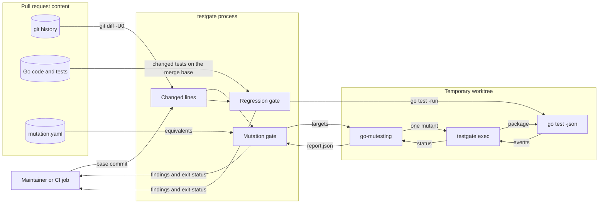

# Design 0002: Mutation testing on changed lines and regression proof

Issue: #557 (chunk 06 of the Go port).

## Problem

The Python implementation has no mutation testing, and no check proves that a
regression test fails on the code before its fix. ADR 0047 makes both merge
standards for the Go code.

## Design

`tools/testgate` has three modes: `mutation`, `regression`, and `exec`. Each
mode takes the base commit with `-base`. The exit status is 0 with no
findings, 1 with findings, 2 for invalid usage, and 3 when the tool cannot
complete, as for `archcheck`.

### Changed lines

Both gates use the lines that `git diff -U0 --merge-base <base> HEAD` adds or
changes. `github.com/bluekeyes/go-gitdiff` parses the diff. The mutation gate uses the Go files that are not test files and that
are not in a `testdata` directory. The regression gate uses the test files.
The gates read only committed code, so commit the work before you run them.

### The mutation gate

`testgate mutation` mutates the changed lines and fails when a mutant
survives.

1. The gate makes a temporary git worktree of `HEAD`, because go-mutesting
   changes the files in place.
2. It runs go-mutesting on each changed file in that worktree. `mise.toml`
   pins go-mutesting. The gate writes the go-mutesting configuration: a JSON
   report, and no rule that skips files.
3. The gate gives itself to go-mutesting as the exec command, `testgate exec`.
   go-mutesting mutates whole files, so the gate also writes the changed lines
   to a file in the worktree.
4. For each mutant, `testgate exec` finds the changed lines of the mutant by a
   comparison of the original source and the mutated source. A mutant that
   changes no changed line, or that does not change the source, is out of
   scope. The exec step reports it as killed without a test run, and the gate
   counts it as skipped.
5. For a mutant in scope, `testgate exec` puts the mutant in place and runs
   `go test -json` on the package. It reports the mutant as killed when a test
   fails, as escaped when the tests pass, and as not compiled when a
   `build-fail` event occurs. Then it restores the file. The tests of one
   mutant have a time limit of 1 minute, and each of their processes has an
   address space limit of 4 GiB.
6. The gate reads the JSON report, and finds the lines of each mutant in the
   same way.
7. An escaped mutant on a changed line is a finding, unless it is
   equivalent. The fix-it message tells you to add a test that fails with the
   mutation, or to record the mutant with the reason.
8. The gate removes the temporary worktree.

`testgate mutation -all` mutates every Go file of the module that is not a
test file. It also reports each record in `mutation.yaml` that matches no
mutant, because such a record is stale. A weekly workflow runs it.

Each run reports the score of each package directory: the killed mutants as a
percentage of the killed and the surviving mutants. Equivalent mutants and
mutants that do not compile are not part of the score. The threshold is 100%:
each surviving mutant is a finding. A change to the threshold is a change to
the code of the gate, so it gets a review.

The gate does not use the built-in exec of go-mutesting, for two reasons:

- The built-in exec counts a mutant that does not compile as killed. `go test`
  exits with status 1 for a build failure and for a test failure. Such a
  mutant can hide an untested statement.
- Each mutant runs in the package directory, so the output of `go test -json`
  identifies the build failure exactly.

A mutant can make a loop run without end. When such a loop allocates, the
memory of the test run grows until the time limit. In a trial run, such a
mutant filled the 16 GiB memory limit of the terminal session, and the OOM
killer stopped the session. The address space limit stops the test process
with an out-of-memory error first. Linux enforces the limit, and the whole Go
test suite passes with 2 GiB.

The go-mutesting command does not register its `conditional/negated`
mutator. So no mutant changes `==` to `!=` or `<` to `>=`, and a statement
such as `return a == b` gets no mutant. This gap is temporary. The fork
OpenRAE/go-rae-gremlins will replace go-mutesting when it fixes the defects
that OpenRAE/go-rae-gremlins#1 records.

The gate does not use `skip_without_test`. That option skips each file that
has no test file with the same name, also when other test files cover it.

### Equivalent mutants

An equivalent mutant changes no behavior that a test can observe.
`mutation.yaml` records each one: the file, the function, the mutator, the
first changed line, that line in the mutant, and the reason. A seventh value,
the occurrence, tells identical lines of one function apart.

- The gate matches a record by these values and not by the line number, so a
  record stays valid when lines move.
- A record covers one mutant, so a second identical mutant needs its own
  record. A record that names the mutated text cannot hide another mutation
  of the same line. A record that names the occurrence cannot hide a second
  identical line.
- The reason must tell why no test can observe the change.
- The gate has no automatic rule. An earlier rule took each numbers mutant of
  a result beside a non-nil error as equivalent. A review found it unsound: a
  variable such as `err` can be nil, and a function can document a partial
  result. The gate code returns `ExecFailed` with each error instead of a
  number.

### The regression proof

`testgate regression` proves that each new regression test fails on the code
before the fix.

- A regression test is a `Test` function whose doc comment contains the text
  `Regression test for #`, followed by the issue number.
- The gate finds the regression tests whose lines the change adds or changes.
- For each package with such a test, the gate makes a temporary worktree of
  the merge base. It copies in the changed test files and the changed
  `testdata` files of that package, and runs each regression test there with
  `go test -json`.
- A regression test that passes on the merge base is a finding.
- A regression test that does not compile on the merge base is also a
  finding. A test that does not compile cannot show the defect. Write the test
  against the API that the merge base has.
- The gate removes the temporary worktree.

### One strict YAML decoder

The architecture checker and the mutation gate both decode trusted YAML
strictly: one document, and no field that the target type does not declare.
The new `strictyaml` package holds that one implementation, and both tools use
it. Chunk 11 extends the same package with the bounds that pack-owned documents
need.

### One report of the findings

The architecture checker and the test gates report findings in the same form,
and their commands use the same exit statuses. The new `report` package holds
the finding type, its order, and the exit statuses. Its streams buffer the
output of a command with `bufio.Writer`. A `bufio.Writer` keeps the first
write error, so a command checks one error when it flushes the output.

### Effects

The gates run `git`, `go-mutesting`, and `go test`. A small runner interface
carries the process execution, so that the unit tests replace it. The main
package passes the environment to the runner, because library code does not
read the environment.

### Make targets and CI

- `make go-mutation` and `make go-regression` run the gates against `BASE`.
  The default is `origin/go-cutover`, the integration branch of the port. The
  cutover changes it to `origin/dev`.
- `make go-mutation-all` runs `testgate mutation -all`.
- `ci.yml` gets the jobs `go-mutation` and `go-regression`, and `verify`
  requires both. A job fetches the full history. The base is the base commit
  of the pull request, or the commit before a push.
- `mutation.yml` runs `make go-mutation-all` each week, and on request.

## Systems security engineering

The gates are merge gates. They run on the content of a pull request in CI:
its Go code, its tests, `mutation.yaml`, and its history. They run that code
with `go test`, as the other CI jobs do.

| Asset | Protection need |
| --- | --- |
| Merge decision (the exit status of a gate) | Integrity |
| CI runner and the maintainer machine | Integrity and availability |

| Threat | Boundary | Control | Verification |
| --- | --- | --- | --- |
| A revision or a path from the change becomes an option of git. | Change to git | The gate resolves each revision with `git rev-parse --verify --end-of-options`, and it puts each path after `--` or in a position that takes only a path. | `TestRevParse`, `TestChangedLines`. |
| A malformed diff makes the gate skip changed lines. | git to gate | `go-gitdiff` rejects a diff whose hunk headers or line counts do not agree. | `TestParseDiffErrors`. |
| A mutant allocates memory without end and stops the machine. | Mutant to host | Each test process of a mutant has an address space limit, and the tests of a mutant have a time limit. | `TestRunExecMemory`. |
| A mutant that does not compile counts as killed and hides an untested statement. | go-mutesting to gate | The exec step reads the `build-fail` event of `go test -json` and reports the mutant as not compiled. | `TestExecStatus`. |
| A record in `mutation.yaml` hides a real survivor. | Change to gate | A record names the mutated text and covers one mutant. It needs a reason, and review checks it. The weekly run reports each record that matches no mutant. | `TestRecordsMatch`, `TestEvaluateOneRecordPerMutant`, `TestMutationAll`. |
| A test that starts a process reads the variables of go-mutesting and fails for a reason other than the mutant, which counts as a kill. | Exec step to tests | The gates start each process without the `MUTATE_` variables. | `TestWithoutMutation`, `TestMainProcess`. |
| A regression test that skips, or does not compile, passes the proof. | Change to gate | Only a test failure on the merge base proves the test. | `TestRegression`, `TestRegressionBuildFailure`. |

Residual risk: the gates run the tests of the pull request, as the `go` job
does. Branch protection and review control which code runs in CI.

## Data flow

## Packages

| Package | Component | Purpose |
| --- | --- | --- |
| `github.com/OpenRAE/env-packs/internal/strictyaml` | `strict-yaml` | Decodes exactly one YAML document, and rejects unknown fields. |
| `github.com/OpenRAE/env-packs/internal/report` | `report` | The finding type, its order, the output streams, and the exit statuses of the repository tools. |
| `github.com/OpenRAE/env-packs/internal/testgate` | `test-gates` | The changed lines, the mutation report, the equivalent records, the regression proof, and the runner. |
| `github.com/OpenRAE/env-packs/tools/testgate` | `test-gates` | The command that runs the gates and the exec step. |

## New modules

| Module | Used by | Reason |
| --- | --- | --- |
| `go.yaml.in/yaml/v3` | `strict-yaml` | Moves from `architecture` to `strict-yaml`, the one YAML decoder of the tools. |
| `github.com/bluekeyes/go-gitdiff` | `test-gates` | Parses the output of `git diff`, with quoted paths and checked line counts. It has no dependencies, and gitleaks uses a fork of it. |

`mise.toml` pins go-mutesting. The gate runs it as a command, so it is not a
module dependency.

## Alternatives

- Gremlins 0.6.0 has a filter for changed lines. In a trial on chunk 04, it
  ran the tests of a main package at the module root. So each mutant of a
  main package survived. It also reported covered `case` expressions as not
  covered, and it mutated files in `testdata`.
- A threshold below 100% lets a known survivor merge. With records of the
  equivalent mutants, each other survivor is a missing test.
- `github.com/golangci/revgrep` finds the changed lines for golangci-lint. Its
  parser panics on a malformed hunk header, writes to stderr from library
  code, and does not unquote quoted paths.
