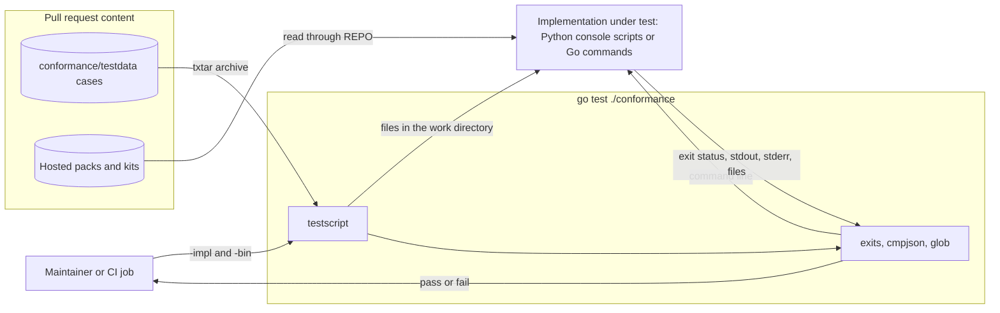

# Design 0003: Conformance corpus for the external contracts

Issue: #560 (chunk 09 of the Go port).

## Problem

The external contracts of env-packs are in the pack layout, the schemas, 11
console scripts, the library, and the MCP tools. The Go port must keep them
(ADR 0047). No executable description of the external behavior exists. So
nothing shows that a Go command behaves as the Python command does.

## Design

### Cases

- Each case is a testscript file in txtar format, in
  `conformance/testdata/<command>/`. The name of the directory is the name of
  the command.
- A case holds its inputs as files in the archive: pack trees, input
  documents, and expected outputs.
- A case runs a command with `exits <status> <command> <arguments>`, which
  checks the exit status. The testscript commands `stdout` and `stderr` then
  check the output streams with regular expressions.
- `cmp` compares exact bytes, and `cmpjson` compares the decoded JSON. The
  choice of the two records what the contract requires.
- A case can read the hosted packs and kits without changes. The variable
  `$REPO` names the repository root. A case writes only in its work directory.

### The implementation under test

- `go test ./conformance -args -impl=python` runs the corpus against the
  Python console scripts on `PATH`.
- `-impl=go -bin <dir>` runs the corpus against the Go commands in `<dir>`. The
  runner puts `<dir>` first on `PATH`.
- Without `-impl`, the corpus test skips. So `make go-check` passes without the
  Python implementation.

### Deviations

- When the Python implementation differs from the written contract, the case
  states the contract. It starts with `[python] skip 'deviation: <reason>
  (#<issue>)'`, where the issue resolves the deviation.
- A test checks that each skip for Python has a reason and an issue number.

### Make target and CI

- `make conformance` runs the corpus against the Python implementation.
- The `conformance` CI job installs the hash-locked Python package and runs
  `make conformance`, and `verify` requires it. The job runs on each pull
  request. A path filter would skip the job, and `verify` fails closed on a
  skipped job.

### Cases of this chunk

Each command has a case for each exit status that an input can cause, with the
class of each output stream. Each later port chunk adds the cases for its own
surface before its Go code merges.

No case covers these exit statuses:

- Status 3 of `raes-pack-check`, `raes-pack-catalog`, `raes-pack-kit`,
  `raes-pack-verify`, and `raes-pack-dist`. It marks a tool failure: an
  internal defect, an interrupted kit change that needs recovery, or a host
  without atomic file moves. No pack, argument, or input causes it. A case
  would record a defect as the contract. The unit tests of each
  implementation cover these paths.
- Status 0 of `raes-pack-issue-skeleton`. The command reads GitHub, and the
  corpus does not use the network.

## Systems security engineering

The corpus is a merge gate. A pull request can change each case, and the
implementation under test runs as a child process of `go test`.

| Asset | Protection need |
| --- | --- |
| The recorded contract (the cases) | Integrity |
| Merge decision (the result of the corpus) | Integrity |
| The repository checkout that the cases read | Integrity |

| Threat | Boundary | Control | Verification |
| --- | --- | --- | --- |
| A skip for Python hides a break of the contract. | Case to runner | Each `[python] skip` must give a reason and the issue that resolves the deviation. | `TestPythonSkipsNameAnIssue`. |
| A case passes for the wrong reason, for example with a loose match of the output. | Case to runner | `exits` checks the exact exit status. A case compares the output with `cmp` for exact bytes or with `cmpjson` for decoded content, as the contract requires. | Review of each case. |
| A case changes the hosted packs or kits that other cases read. | Case to checkout | testscript runs each case in its own temporary work directory. A case only reads `$REPO`. | Review of each case. |
| The wrong implementation runs, for example a stale binary on `PATH`. | Runner to command | `-impl=go` needs `-bin`, and the runner puts that directory first on `PATH`. The CI job installs the hash-locked Python package. | The runner fails for an unknown `-impl` and for `-impl=go` without `-bin`. |

Residual risk: no tool stops a case from a write to `$REPO`. Review and the
clean checkout of each CI job limit the effect.

## Data flow

## Packages

| Package | Component | Purpose |
| --- | --- | --- |
| `github.com/OpenRAE/env-packs/conformance` | `conformance` | The corpus runner and the cases. |

## New modules

| Module | Used by | Reason |
| --- | --- | --- |
| `github.com/rogpeppe/go-internal` | `conformance` | `testscript` runs scripts in txtar files, with files, commands, and output checks. It comes from the script tests of the go command. |

## Alternatives

- A table test with golden files for each command needs harness code for each
  command, and it cannot hold a pack tree as text.
- A Python runner would not outlive the Python implementation.
