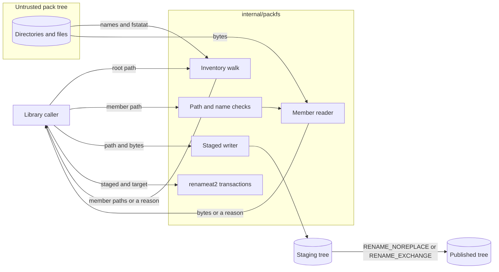

# Design 0004: The pack filesystem boundary and the staged transactions

Issue: #561 (chunk 10 of the Go port).

## Problem

A pack is input that the tools do not trust. The Python code reads a pack through
`_pack_fs.py`, which anchors each read to an open root descriptor and rejects
unsafe members. It commits staged trees with `renameat2` in
`_transactions.py`. Each caller gives its own exception class, so one failure
has different types in different modules. Some modules also read pack files by
path, outside the boundary.

## Design

### One package opens pack content

`internal/packfs` is the only library package that opens pack content. The
rule `files-through-packfs` excepts it, and the rule also rejects the imports
`golang.org/x/sys/unix` and `syscall` in the other library packages.

### Reads

- `Open` opens a pack root with `os.OpenFile`, `O_DIRECTORY`, and
  `O_NOFOLLOW`. It rejects an empty path, a symlink, and a path that is not an
  accessible directory.
- `Root.Inventory` walks the tree from the root descriptor. It opens each
  directory with `openat` and `O_NOFOLLOW`, and it inspects each member with
  `fstatat` and `AT_SYMLINK_NOFOLLOW`. It rejects these members:
  - a symlink, a special file, and a file with more than one link;
  - a name that is not NFC or not UTF-8;
  - two paths that are equal after Unicode case folding.

  `os.File.Readdirnames` lists each directory. Each read asks for one name
  more than the member budget has left, so the walk never holds more names
  than the budget. Each directory entry counts against the budget. The result
  is in a fixed order: the names of each directory in byte order, depth first.
- `Root.OpenMember` checks that the path is canonical, opens each directory
  with `O_NOFOLLOW`, and opens the file with `O_NOFOLLOW` and `O_NONBLOCK`. The
  file must be a regular file with one link.
- `Root.ReadMember` reads a member with `io.ReadAll` through `io.LimitReader`,
  up to one byte more than the byte budget.
- `golang.org/x/sys/unix` gives `openat` and `fstatat`, which the `os` package
  does not have. The reads work on Linux and macOS.
- As `os.ReadDir` does, the package does not report a failed close of a
  descriptor that it opened only to look up names or to read. Such a close
  loses no data.

### Writes and transactions

- `WriteMember` writes one file below a fresh staging root, through
  descriptors and with `O_NOFOLLOW`. A directory gets the mode `0755`, and a
  file gets the mode `0600`. The operation does not copy ownership, access
  control lists, extended attributes, or set-id bits. A failed close of the
  written file fails the write.
- `PublishNew` moves a complete staged tree to an absent target with
  `renameat2` and `RENAME_NOREPLACE`.
- `Exchange` swaps a staged tree and an existing target with `renameat2` and
  `RENAME_EXCHANGE`.
- `Replace` exchanges the trees, and then checks the tree that it replaced.
  When the check fails, it exchanges the trees back. When that exchange fails,
  it returns the reason `recovery`, with the path that keeps the original tree
  (ADR 0035).
- The transactions need Linux, as in the Python code. On another platform they
  return the reason `unsupported-platform`.

### Admission of authoring input

- `AdmitMembers` ports `_authoring_safety.py`. It rejects an authoring input
  with a member named `raes-trust.yaml`, in any letter case. Then the RAES
  resolver keeps its empty registry policy and refuses remote imports. It does
  not open a member.
- The port does not keep the operator-name list of `_authoring_safety.py`.
  The maintainer decided that the list is not an idiomatic check for the MCP
  tools (#561).

### One error type

Each operation returns an `*Error` with a stable reason code, such as
`symlink`, `hardlink`, `special-file`, `member-budget`, or `byte-budget`. The
message of each error is the message of the Python code, so a diagnostic can
keep its text.

### The architecture check reads each platform

The transactions need a file for Linux and a file for the other platforms.
`go/packages` reads one build configuration, so the code check reported the
file of the other platforms as unread. The model now names the release
targets in `platforms`. `archcheck check` loads the code once for each
platform, without cgo, and merges the results. A path is unread only when no
platform reads it.

`make go-lint` also runs golangci-lint once for each platform, so that it
lints each build-constrained file. `archcheck platforms` lists the platforms
of the model for it.

### Tests

- Unit tests cover each rejection, the budgets, the order, the exclusions, and
  each transaction: create, exchange, conflict, and recovery.
- A small interface holds the three system calls that a real tree cannot fail
  on demand: `openat`, `fstatat`, and `renameat2`. The fault tests replace it.
  To fail an operation of `os.File`, a fault returns a file whose descriptor
  is not open, or a file that is open for writing only.
- Each fault test checks that the operation leaves no descriptor open. It
  counts the entries of `/dev/fd` before and after the operation.
- Fuzz targets cover the path check and the inventory of a generated tree.
- Conformance cases cover each rejection through `raes-pack-check`.

## Systems security engineering

| Asset | Protection need |
| --- | --- |
| The pack content that a tool reads | Integrity |
| Files outside the pack root | Confidentiality and integrity |
| The tool process and the host | Availability |
| An existing tree that a transaction replaces | Integrity |

| Threat | Boundary | Control | Verification |
| --- | --- | --- | --- |
| A symlink or `..` makes a read or a write leave the root. | Pack tree to reader | Each component opens with `openat` and `O_NOFOLLOW` from a descriptor. `NormalizeRelpath` rejects `..`, an absolute path, and a backslash. | `TestOpenMemberRejections`, `TestInventoryRejections`, `FuzzNormalizeRelpath`. |
| A hardlink aliases a file outside the pack. | Pack tree to reader | The walk and the member open reject a file with more than one link. | `TestInventoryRejections`, `unsafe-members.txtar`. |
| A FIFO or a device blocks or exhausts the tool. | Pack tree to reader | `O_NONBLOCK` on the open, and only a regular file passes the type check. | `TestOpenMemberRejections`, `unsafe-members.txtar`. |
| A tree with many entries, or a large file, exhausts memory. | Pack tree to reader | The member budget bounds each listing, and the byte budget bounds each read. | `TestInventoryMemberBudget`, `TestReadMember`, `budgets.txtar`. |
| Two names that differ only in case or in Unicode form collide on another file system. | Pack tree to reader | The walk rejects a name that is not NFC, and two paths that are equal after case folding. | `TestInventoryRejections`, `unsafe-members.txtar`. |
| A failed replacement loses the original tree. | Transaction to file system | `renameat2` exchanges the trees atomically. A failed rollback returns the path that keeps the original tree. | `TestReplaceRollbackFault`. |
| An error path leaks descriptors until the tool fails. | Package to process | Each fault test checks the count of open descriptors. | `TestInventoryFaults`, `TestOpenMemberFaults`, `TestWriteMemberFaults`. |

Residual risk: a process that changes the tree during a walk can replace a
checked directory with another directory below the root. The reads still stay
below the root, because each component opens without following a symlink.
The hosts must not change a source tree during a read (`docs/public/mcp.md`).

## Data flow

## Packages

| Package | Component | Purpose |
| --- | --- | --- |
| `github.com/OpenRAE/env-packs/internal/packfs` | `packfs` | Descriptor-anchored reads, staged writes, and atomic transactions for pack trees. |

## New modules

| Module | Used by | Reason |
| --- | --- | --- |
| `golang.org/x/sys` | `packfs` | `openat`, `fstatat`, `mkdirat`, and `renameat2` on descriptors. |
| `golang.org/x/text` | `packfs` | NFC normalization and Unicode case folding, as Python does them. |

## Alternatives

- `os.Root` follows a symlink that stays inside the root. The pack rules
  reject each symlink, and `os.Root` does not give the descriptor that
  `fstatat` needs.
- `openat2` with `RESOLVE_NO_SYMLINKS` exists only on Linux. The reads must
  also work on macOS.
- A read of raw directory entries with `getdents` copies what
  `os.File.Readdirnames` does, so the walk uses `Readdirnames`.
