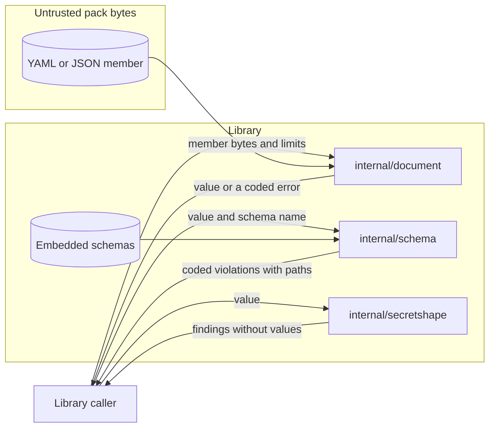

# Design 0005: Strict document ingest and full schema validation

Issue: #562 (chunk 11 of the Go port).

## Problem

The Python code reads pack-owned YAML in three ways. Only `validation.py`
rejects duplicate keys and bounds the YAML events. `release.py` and
`content_ci.py` call `yaml.safe_load` without either check. It validates pack
documents with a hand-written subset of JSON Schema that does not enforce
`minLength`, `maxLength`, `minimum`, `uniqueItems`, `format`, or a schema for
`additionalProperties`. The policy for secret-shaped values has two identical
copies, in `validation.py` and `kits.py`.

## Design

### One decoder for pack-owned documents

`internal/document` decodes each pack-owned YAML and JSON document. RAES-owned
documents use the RAES loaders (chunk 01), not this package.

- `DecodeYAML` reads one YAML document with `go.yaml.in/yaml/v3`. It walks the
  node tree first, and it rejects a document with more nodes, aliases, or
  depth than the limits allow. It also rejects the expansion bound of the
  Python code: the number of nodes times the number of aliases plus one.
- A decode of yaml.v3 copies the anchored node for each alias, and PyYAML
  shares it. So nested aliases can pass the counts and still expand to a very
  large value in Go. `DecodeYAML` also bounds the size of the value after the
  expansion of each alias by the node limit.
- `DecodeJSON` reads one JSON document with `encoding/json`, which keeps the
  digits of each number, and then with `encoding/json/jsontext`, which rejects
  a duplicate name. The module needs Go 1.27, the first release with
  `jsontext`. A walk of the result applies the node and depth limits.
- Both decoders reject these documents:
  - a duplicate mapping key, or a key that is not a string;
  - invalid UTF-8, more than one document, or a top-level null;
  - a number that is not finite;
  - a document larger than the byte limit.
- `DecodeYAML` also rejects an explicit tag, because the readers construct
  tagged values in different ways.
- `DecodeYAML` rejects an alias inside its own anchor with the code
  `document.alias-cycle`. Such a value holds itself, and JSON has no such
  value.
- The decode of yaml.v3 also fails when more than 99 percent of its nodes come
  from aliases. `DecodeYAML` reports this failure as `document.alias-limit`.
  The Python code accepts such a document.
- The limits are those of `PackValidationLimits`: 1 MiB of metadata, 20,000
  nodes, 64 aliases, and a depth of 64.
- Each failure is an `*Error` with a stable code, such as
  `document.duplicate-key` or `document.alias-limit`. No error holds the text
  of the document or of the parser.
- Pack validation reports a decoder failure with the code that the Python code
  gives to that failure, such as `yaml.duplicate-key`. A failure that only the
  Go decoder finds, such as `document.ambiguous-scalar`, is `yaml.invalid`.

### Plain scalars that YAML 1.1 and YAML 1.2 read differently

The Python code reads YAML with the YAML 1.1 rules of PyYAML.
`go.yaml.in/yaml/v3` mixes YAML 1.1 and YAML 1.2 rules. So some plain scalars
have different values in the two readers:

- `yes`, `no`, `on`, and `off` in each letter case, which PyYAML reads as
  booleans and the Go reader reads as strings;
- `1e3`, `1.5e3`, `0o755`, and `012345678`, which PyYAML reads as strings and
  the Go reader reads as numbers;
- the sexagesimal numbers, such as `1:30`, which PyYAML reads as numbers;
- the dates and times, such as `2026-11-01`, which have no JSON type;
- the merge key `<<`, which the strict loader of the Python code rejects.

`DecodeYAML` resolves each plain scalar with the rules of PyYAML and with the
rules of the Go reader. When the two values differ, it rejects the scalar with
the code `document.ambiguous-scalar`, so a value never changes its meaning in
the port. A quoted scalar is a string in
both versions, so it passes. No hosted pack or kit metadata file has such a
scalar. The corpus records that Python accepts them.

### Full JSON Schema validation

`internal/schema` validates a document with
`github.com/santhosh-tekuri/jsonschema/v6`, a JSON Schema 2020-12 validator that
passes the official JSON Schema test suite without its optional tests.

- The root package embeds the packaged schemas from
  `src/raes_env_packs/resources/schemas/` without changes. `internal/schema`
  decodes them with `internal/document` and compiles each one once.
- The validator asserts `format`, so a `date-time` value must be an RFC 3339
  date and time.
- The compiler gets an empty URL loader. A reference can only point into the
  embedded schemas, and it never loads a file or a URL.
- Each failure is a violation with a stable code and a field path. The codes
  of the Python subset stay: `type`, `const`, `enum`, `pattern`, `required`,
  `unknown`, and `min-items`. The new keywords add `min-length`, `max-length`,
  `minimum`, `unique-items`, and `format`. A value that a whole subschema
  rejects, such as a `false` schema, gets the code `schema`. No packaged schema
  has such a subschema.
- A path has the form of the Python paths, such as `$.pack.name` or
  `$.files[2]`. No violation holds a message of the validator.
- The diagnostics catalog (chunk 12) gives each new code a hint, as `check.py`
  does for the codes of the subset.
- `authoring.py` checks the arguments of the MCP tools with `jsonschema`. The
  Go port of the MCP tools uses the same validator, so the Go code has one JSON
  Schema validator.

### One secret-shape policy

`internal/secretshape` holds the one policy of `validation.py` and `kits.py`.
Chunks 13 and 20 use it, so no copy stays.

- A key or a parameter name is secret-shaped when it holds a fragment such as
  `token` or `private_key`. The match folds the letter case with Unicode case
  folding, as `str.casefold` does in Python.
- A value is secret-shaped when it matches a pattern of the Python code. The
  patterns find a private key, a signature or a token in a query, and
  credentials in a URL. They also find a JSON Web Token and a GitHub or AWS
  access key.
- A parameter value or a source revision must also not be an environment
  coordinate, such as `${NAME}` or `env:NAME`.
- A scan of a document reads the keys of each mapping and each string. The
  Python scan reads only the values of mappings, so it skips a string in an
  array. No hosted kit has a secret-shaped string in an array.
- Python reads `\s` in the patterns as Unicode white space, and the RE2 engine
  of Go reads it as ASCII white space. So the Go patterns also match a few
  values with Unicode white space.

The rule in `publication.py` is not part of this policy. It applies to the keys
and the URL queries of a publication profile, with exact key names and an
allow list of query keys. A merge would change what the pack and kit checks
accept, for example a key with `entitlement`. Chunk 17 ports that rule with the
publication contract.

## Systems security engineering

| Asset | Protection need |
| --- | --- |
| The tool process and the host | Availability |
| The validation result of a pack | Integrity |

| Threat | Boundary | Control | Verification |
| --- | --- | --- | --- |
| Nested aliases or deep nesting exhaust memory or the stack. | Pack bytes to decoder | The node, alias, depth, and expansion limits, and the bound on the expanded size. The walk of the node tree checks them before a decode, and it rejects an alias inside its own anchor. | `TestDecodeYAMLLimits`, `TestDecodeYAMLExpansion`, `TestExpandedSize`, `TestDecodeYAMLRejections`, and `FuzzDecodeYAML`. |
| A duplicate key hides a second value from one reader. | Pack bytes to decoder | Both decoders reject a duplicate key. | Unit tests and conformance cases. |
| A plain scalar means one thing in Python and another in Go. | Pack bytes to decoder | `document.ambiguous-scalar`. | Unit tests and a conformance case. |
| A schema keyword that the validator skips lets a defect through. | Document to validator | A 2020-12 validator that passes the official test suite, with `format` asserted. | `TestValidate` and a conformance case for each keyword. |
| A schema reference loads a file or a URL. | Schema to validator | The compiler has an empty URL loader. Each packaged schema refers only to its own `$defs`. | `TestCompileErrors` and `TestCompile`. |
| A pattern with catastrophic backtracking stalls the validator. | Schema to validator | The validator uses the RE2 engine of Go, which runs in linear time. | Design of `regexp`. |
| A diagnostic leaks document text. | Validator to caller | Codes and field paths only. | Unit tests. |
| A secret-shaped key or value passes the policy, for example with a Unicode letter or in an array. | Document to policy | Unicode case folding, as in Python, and a scan of each string. | `TestMatchKey`, `TestMatchValue`, and `TestScan`. |

## Data flow

## Packages

| Package | Component | Purpose |
| --- | --- | --- |
| `github.com/OpenRAE/env-packs/internal/document` | `document` | Strict, bounded decoding of pack-owned YAML and JSON. |
| `github.com/OpenRAE/env-packs/internal/schema` | `schema` | The packaged schemas and their full validation, with stable codes. |
| `github.com/OpenRAE/env-packs/internal/secretshape` | `secret-shape` | The one policy for secret-shaped keys and values. |

## New modules

| Module | Used by | Reason |
| --- | --- | --- |
| `go.yaml.in/yaml/v3` | `document` | The node tree of a YAML document, for the limits and the scalar check. The tools already use it for their own YAML. |
| `github.com/santhosh-tekuri/jsonschema/v6` | `schema` | A full JSON Schema 2020-12 validator with typed error kinds. At run time it uses only the standard library and `golang.org/x/text`. |
| `golang.org/x/text` | `secret-shape` | Unicode case folding, as Python does it. `packfs` already uses the module. |

## Alternatives

- A hand-written subset validator is the defect of the Python code. It misses
  keywords, and each new keyword needs new code.
- `github.com/xeipuuv/gojsonschema` supports drafts 4, 6, and 7, not 2020-12.
- Copying the YAML 1.1 meanings into the Go decoder would need a custom
  resolver. The rejection of the ambiguous scalars is smaller and keeps each
  value unambiguous.
