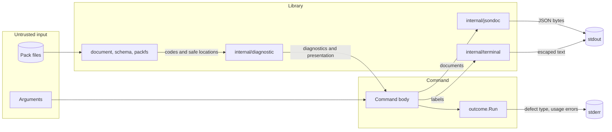

# Design 0006: One diagnostic model and one command outcome contract

Issue: #563 (chunk 12 of the Go port).

## Problem

The Python code reports problems in six shapes: `validation.Diagnostic`,
`catalog.CatalogDiagnostic`, `publication.PublicationViolation`,
`verify.Evidence`, plain strings in `content_ci.py` and `release.py`, and 13
exception classes. ADR 0031 names one diagnostic envelope. Each command has its
own copy of the exit statuses. The JSON output has several forms, and terminal
escaping has two copies.

## Design

### One diagnostic type

`internal/diagnostic` defines the one diagnostic type of the product:

- A `Diagnostic` has a stable code, a file, and a field. The file is a
  pack-relative member path, and the field is a pointer into that member, such
  as `$.pack.name`. Both are optional.
- A file must be a valid path for `io/fs`: relative, slash-separated, and
  without `.` or `..` elements. Any other file is a defect, and the package
  panics without the path in the message. So no absolute path can enter a
  diagnostic.
- A diagnostic holds no message. The catalog gives its presentation, by
  code.

Each later chunk reports a problem with this type:

| Python shape | Go |
| --- | --- |
| `validation.Diagnostic` | A `Diagnostic`. |
| `catalog.CatalogDiagnostic` | A `Diagnostic`. The catalog result keeps the source id and the pack name beside it. |
| `publication.PublicationViolation` | A `Diagnostic` with the field. |
| Strings in `content_ci.py` and `release.py` | A `Diagnostic`. |
| The exception classes | An error of the operation, such as `packfs.Error`. The caller turns an expected failure into a `Diagnostic` or a fixed message. |

`verify.Evidence` records a gate and its state, also when the gate passes. It
is part of the envelope of `raes-pack-verify`, so the verify chunk keeps it. A
failed gate also reports a `Diagnostic`.

The repository tools keep `report.Finding`. Its message names files and
packages of this repository for its developers, which a pack diagnostic must
not do.

### The presentation catalog

The catalog is the catalog of `check.py`, with the same text:

- It is the embedded data file `catalog.json`, so the code holds no table of
  text. A command makes one `Catalog` with `NewCatalog`, and the catalog gives
  the presentation of each diagnostic.
- Each entry has a severity, a domain, an owner, an explanation, a reason, and
  a suggestion. A code takes the entry of its longest dotted prefix.
- A `*.schema.<keyword>` code adds the hint of its keyword to the suggestion.
  New hints cover `min-length`, `max-length`, `minimum`, `unique-items`, and
  `format` (design 0005).
- A code without an entry gets the generic entry. It holds no text of the
  code.
- The documentation target is `docs/public/checking.md` with the anchor of the
  domain. A test checks that each anchor is a heading of that page.

### The diagnostic list

A `List` collects the diagnostics of one operation, as `_Errors` does:

- It keeps at most the first `max` diagnostics.
- It cuts the file and the field to `chars` characters, and the message
  `code: file:field` to `chars` characters.
- It removes a diagnostic with the same message as an earlier one, and it sorts
  the diagnostics by message. So the order is the order of the Python results.

The defaults of the pack checks are 100 diagnostics and 240 characters.

### The command outcome contract

`internal/outcome` holds the process contract of the commands and of the
repository tools (ADR 0031, ADR 0047):

- The statuses are `OK` (0), `Blocking` (1), `Usage` (2), and `ToolFailure`
  (3). `raes-pack-validate` and `raes-pack-release` use only 0, 1, and the
  usage status of their flag parser.
- `Streams` buffers stdout and stderr. A failed write gives `ToolFailure`, so a
  full disk or a closed pipe is never a success.
- `Run` runs the body of a command. The body handles its expected failures and
  returns a status. An error from the body, or a panic, is a defect. `Run`
  writes `<command>: internal error (<type>)` to stderr and returns
  `ToolFailure`. The message holds the Go type of the error, and never its
  text, because the text can hold a path or a value.
- In JSON mode, a command writes only the JSON document to stdout. Usage
  errors and defects go to stderr.

The repository tools move from `report` to these statuses and streams, so the
statuses have one definition.

### One JSON writer

`internal/jsondoc` writes the JSON envelopes and documents. Its bytes are those
of `json.dumps(value, indent=2, sort_keys=True, ensure_ascii=False)` in Python,
and a newline. The SBOM and the provenance statement have digests over these
bytes, so a different byte changes a digest.

- `encoding/json/jsontext` writes the tokens with an indent of two spaces, a
  space after each colon, and no escape for HTML or JavaScript. A test shows
  that these options give the bytes of Python for strings and nesting.
- The writer sorts the keys of each object.
- It writes numbers as Python does. An integer keeps its digits. A float has
  the shortest digits that read back as the same value. It is in positional
  form with at least one decimal, from 0.0001 up to 10^16, and in exponent form
  outside that range. A `json.Number` takes the form that Python gives after
  `json.loads`.
- It returns an error for a number that is not finite and for a value of
  another Go type. Python writes `NaN` and `Infinity`, which are not JSON.

`encoding/json` cannot give these bytes: it escapes U+2028 and U+2029, writes
the float 1.0 as `1`, and keeps the spelling of each `json.Number`.

### One terminal escaping function

`terminal.Escape` writes a label from a pack, a file name, or an argument for a
terminal, as `check._terminal_safe` does. A character that is not printable
becomes `\xNN` below U+0100 and `\uNNNN` above. A byte that is not valid UTF-8
becomes `\udcNN`, the form that Python gives to such a byte in a file name or
an argument. So a control sequence cannot move the cursor, erase the screen, or
spoof a line of the report. JSON output keeps the real value, because the JSON
writer escapes control characters.

Go 1.27 reads Unicode 17, and Python 3.14 reads Unicode 16. So Go writes a
character that only Unicode 17 assigns, and Python escapes it. Each such
character is printable in Unicode 17, so it is not a control character.

### Schema violations

`internal/schema` returns diagnostics. The code is `schema.<keyword>`, such as
`schema.min-length`, and the field is the path of the value. The caller sets the
file and adds its prefix, such as `provenance`, as the Python code does.

## Systems security engineering

| Asset | Protection need |
| --- | --- |
| The terminal of the user | Integrity |
| Paths and values of the user and of a pack | Confidentiality |
| The digests of the release documents | Integrity |
| The exit status of a command | Integrity |

| Threat | Boundary | Control | Verification |
| --- | --- | --- | --- |
| A pack name, file name, or field name holds a control sequence that drives the terminal. | Pack to terminal | `terminal.Escape` on each label in human output. | `TestEscape` and the conformance cases `raes-pack-check/escape` and `raes-pack-catalog/escape`. |
| A diagnostic leaks an absolute path. | Library to output | A file must be a valid `io/fs` path, or the package panics without the path. | `TestNewFile`. |
| A diagnostic leaks an authored value. | Library to output | A diagnostic holds only a code, a file, and a field. The list cuts the file and the field. | `TestList` and the schema tests. |
| A defect message leaks a path or a value. | Command to stderr | `Run` writes only the Go type of the error. | `TestRun`. |
| A panic exits with status 2, which is the usage status. | Command to caller | `Run` recovers a panic and returns `ToolFailure`. | `TestRun`. |
| A failed write of the output looks like a success. | Command to caller | `Streams.Flush` returns `ToolFailure`. | `TestStreamsFlush`. |
| The JSON bytes differ from Python, so a digest changes. | Library to document | The writer gives the bytes of `json.dumps`. | `TestWrite` with bytes from Python, and `TestPythonFloat`. |

## Data flow

## Packages

| Package | Component | Purpose |
| --- | --- | --- |
| `github.com/OpenRAE/env-packs/internal/diagnostic` | `diagnostic` | The diagnostic type, the presentation catalog, and the diagnostic list. |
| `github.com/OpenRAE/env-packs/internal/outcome` | `outcome` | The exit statuses, the output streams, and the handling of defects. |
| `github.com/OpenRAE/env-packs/internal/jsondoc` | `jsondoc` | JSON envelopes and documents with the bytes of the Python code. |
| `github.com/OpenRAE/env-packs/internal/terminal` | `terminal` | The escaping of labels for a terminal. |

## New modules

None. The packages use only the standard library.

## Alternatives

- Presentation fields in each diagnostic copy the catalog into each record, and
  two records with one code can then disagree.
- `encoding/json` cannot give the bytes of Python. See the JSON writer.
- Separate statuses and streams for the repository tools keep two copies of the
  same contract.
