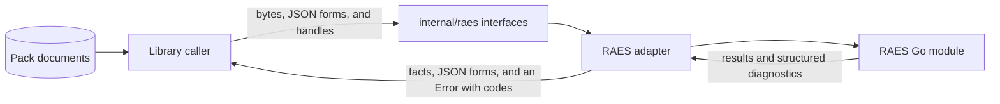

# Design 0007: One interface for the RAES operations

Issue: #552 (chunk 01 of the Go port).

## Problem

The Python code imports 78 RAES symbols from four packages, in nine modules
and one tool. The Go code must reach RAES only through the RAES Go module
(ADR 0047), and the RAES Go module does not exist yet. env-packs needs one
place that lists the RAES operations that it uses. Then its port can adapt to
the RAES Go module as RAES delivers it.

## Design

### The interfaces

`internal/raes` declares the operations as small interfaces, one for each
group: `SDL`, `Digests`, `Language`, `Modules`, `Concepts`, `Artifacts`,
`Requirements`, `ContractValidator`, `BackendProfileLoader`, `Experiments`,
`Planning`, and `Content`. A caller takes the interface that it needs as a parameter, and the
main package of a command gives it the adapter.

`docs/development/raes-operations.md` lists each operation, its methods, and
the RAES issue that delivers it. It maps each of the 78 symbols to its Go
replacement.

### The rule for the types

The interfaces copy no RAES schema, enumeration, address grammar, or validator
(ADR 0009):

- A document that RAES owns passes as its published JSON form. env-packs reads
  only the fields that its own contracts need.
- A parsed scenario is a handle, `Scenario`. It gives its published JSON form,
  from which env-packs reads the facts that it needs. Only the adapter that
  made a scenario accepts it back. A compiled scenario is a handle too.
- The validation of a document against a published RAES contract is one
  method, `ContractValidator.ValidateContract`. So each RAES model that the Python code
  validates needs no Go type here.
- An operation that returns the result of a RAES enumeration returns a fact
  instead. For example, `Concepts.AdmitConceptBindings` reports whether each
  binding resolves to a current concept, and it does not return the outcome
  values of RAES.
- A failure is an `*Error` with the code of RAES and its structured
  diagnostics: code, severity, stage, source, pointer, and range. No failure
  uses the message text of RAES as data.

### The adapter

The adapter implements the interfaces with the RAES Go module. Contract tests
run the adapter against that module for each operation that it delivers. The
RAES Go module does not exist yet, so the adapter and its contract tests wait
for it. A chunk that needs an operation waits for the RAES issue that delivers
it. No chunk replaces an operation with local code.

### The rule `raes-through-adapter`

The rule forbids an import of the RAES Go module in each package. The design
record of the adapter adds the adapter to the exceptions of the rule. The rule
names the path `github.com/OpenRAE/rae/...`, the path of the RAES repository.
That design record changes the path if the RAES Go module uses another one.

## Systems security engineering

| Asset | Protection need |
| --- | --- |
| The boundary between the contracts of RAES and of env-packs (ADR 0009) | Integrity |
| The diagnostics of env-packs | Confidentiality |

| Threat | Boundary | Control | Verification |
| --- | --- | --- | --- |
| A package calls RAES around the interface, so a RAES change breaks it without a contract test. | Library to RAES | The rule `raes-through-adapter`. | `make go-arch`. |
| The message text of RAES, which can hold authored values, enters a diagnostic. | RAES to library | An `*Error` holds codes and structured diagnostics only. | Review of the adapter and its contract tests. |
| env-packs copies a RAES schema, so the two contracts drift. | Library to RAES | Published JSON forms, `ContractValidator.ValidateContract`, and facts instead of RAES enumerations. | Review of each interface change. |

## Data flow

## Packages

| Package | Component | Purpose |
| --- | --- | --- |
| `github.com/OpenRAE/env-packs/internal/raes` | `raes-interface` | The interfaces of the RAES operations that env-packs uses. |

## New modules

None.

## Alternatives

- Go types that copy the RAES models give env-packs a second copy of the RAES
  contracts, which ADR 0009 forbids.
- A call from Go to RAES Python is forbidden (#552).
- An interface that waits for the public Go API of RAES (OpenRAE/rae#1825)
  blocks the chunks that can build on the interface now. The adapter takes the
  API of RAES as it is when RAES delivers it.
