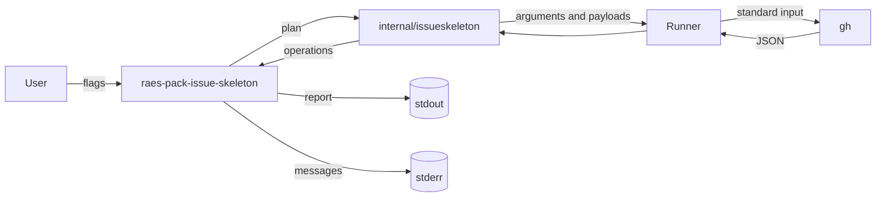

# Design 0008: The issue skeleton helper

Issue: #575 (chunk 24 of the Go port).

## Problem

`raes-pack-issue-skeleton` creates the nine standard planning issues of a new
pack in a GitHub repository through `gh`. It is the first command of the Go
port. It is also the first Go code of the product that starts a process.

## Design

### The library

`internal/issueskeleton` holds the logic of `issue_skeleton.py`:

- The plan of a pack: its id, title, focus, sources, labels, pack root, and
  milestone.
- The nine issue templates and their labels. The package embeds the bodies as
  text templates, which come from the f-strings of the Python code.
- The package renders a body, and then it cleans the body as the `clean`
  function of Python does. It removes the common indent, the outer white
  space, and four spaces at the start of each line. So each body has the bytes
  of the Python body.
- The operations: create the milestone, and create, update, or skip each
  issue. An existing issue matches by its title, or by a former title of its
  template, in the milestone.
- A GitHub client. It builds the arguments of `gh` and reads its JSON output,
  through a `Runner` that the command gives. Each payload goes to `gh` on its
  standard input, and never on its command line.
- `gh api --paginate` writes one JSON array for each page of milestones. The
  client reads each array. The Python code reads only one array, so it fails
  when a repository has more than one page of milestones.
- A message writes the value of an argument as the `repr` function of Python
  does, with `terminal.Quote`. So a control character in the value cannot
  drive the terminal.

### The command

`cmd/raes-pack-issue-skeleton` is the composition root:

- It parses the flags of the Python command and checks the `--repo` selector
  before it starts `gh`.
- Dry run is the default. Only `--apply` writes to GitHub.
- An invalid flag is a usage error with the status 2. A failure that the
  Python code reports with `SystemExit` writes its message to stderr and has
  the status 1. A defect has the status 3 (design 0006).
- The Go flag parser does not accept a prefix of a flag name, as `argparse`
  does. Each full flag name works as before.
- `make conformance-go` builds each Go command and runs its conformance cases
  against it. The CI job `conformance-go` runs it, and `verify` requires it.
- Its `Runner` finds `gh` on `PATH`, and it runs the absolute path of the file
  after symlinks resolve. It refuses a `gh` that other users can replace.
  Others must not have write access to the file, to its directory, or to the
  directory where `PATH` gives `gh`.
- The `Runner` is the only code of the command that starts a process. The rule `no-process-execution` lists the component
  `issue-skeleton-command` as its exception. The only command that it starts
  is `gh`.

## Systems security engineering

| Asset | Protection need |
| --- | --- |
| The issues and milestones of the target repository | Integrity |
| The terminal of the user | Integrity |

| Threat | Boundary | Control | Verification |
| --- | --- | --- | --- |
| A payload on the command line leaks into the process list or a shell. | Command to `gh` | Each payload goes on the standard input of `gh` with `--input -`. | The conformance cases record the arguments of a fake `gh`. |
| A run writes to GitHub by mistake. | User to GitHub | Dry run is the default. | The conformance case of the dry run. |
| A crafted `--repo` value reaches `gh` as a URL or with extra parts. | User to `gh` | The selector must match `OWNER/REPOSITORY` before the first start of `gh`. | `TestValidateRepo`. |
| Text from an argument or from `gh` drives the terminal. | `gh` and arguments to terminal | The messages escape control characters. | `TestValidateRepo`, `TestResolveRepoErrors`, and `TestWritePlan`. |
| A `gh` in a directory that other users can write runs instead of the real `gh`. | `PATH` to command | The `Runner` refuses a `gh`, a directory of `gh`, or the target of a symlink that others can write. It runs the checked absolute path. | `TestGHPathRefusesFilesOthersCanWrite`. |
| The command starts another program. | Command to host | Only the `Runner` of the command starts a process, and it starts only `gh`. | The rule `no-process-execution` and review. |

## Data flow

## Packages

| Package | Component | Purpose |
| --- | --- | --- |
| `github.com/OpenRAE/env-packs/internal/issueskeleton` | `issue-skeleton` | The plan, the templates, the operations, and the GitHub client. |
| `github.com/OpenRAE/env-packs/cmd/raes-pack-issue-skeleton` | `issue-skeleton-command` | The command, and its `Runner` for `gh`. |

## New modules

None.

## Alternatives

- The GitHub REST API from Go needs the network in the command, a token, and
  its own client. `gh` already holds the authentication of the user, as the
  Python command uses it.
- Go string literals for the bodies repeat the same structure nine times. The
  embedded templates keep the text as data.
