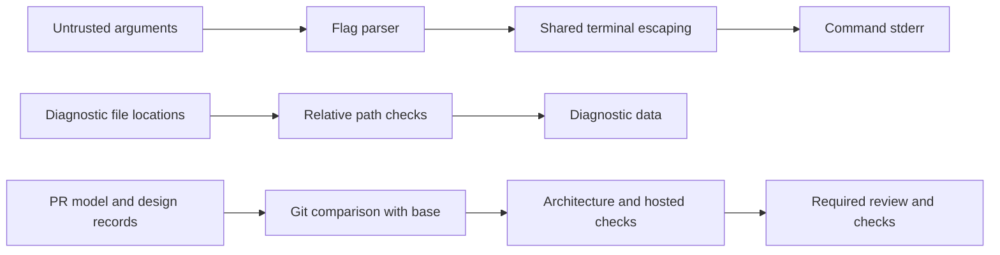

# Design 0009: Go port stabilization

Issue: #617.

## Boundaries and reuse

The port keeps the components and dependencies of design 0008. The command
uses `terminal.Escape` for usage errors. Libraries return errors and data;
they do not write to process streams. The architecture model forbids the
`os.Stdin`, `os.Stdout`, and `os.Stderr` variables in libraries. This also
covers aliases and method calls through those variables, without a new
method-analysis mechanism.

The diagnostic constructor rejects backslashes and drive prefixes in file
locations. Field names remain location data, including authored names. The
terminal adapter escapes them when it writes text. JSON encoders escape
control characters. A field name is not a scalar value; tests must distinguish
these cases. Stable codes and valid pack-relative locations do not change.

## Architecture changes

CI compares the committed model with the PR base through Git. Any model
change requires a new numbered design record in that change. This check
covers rule bodies, scopes, exceptions, and platforms, which the existing
record replay does not cover. The existing replay and C4 checks stay active.
The check uses Git and shell operations; it adds no parser or diff engine.

## Hosted gates

CodeQL runs on each PR, including stacked Go PRs. The title guard runs on
each PR except a promotion into main. An active GitHub ruleset protects the
Go integration branch and the current stack. It requires review, current
verification, fuzzing, CodeQL, and the title check, and permits squash merges
only. The ruleset has no bypass actor. It does not change dev or main.

## Shared checker dependency

The shared checker is `OpenRAE/go-rae-archcheck`. On 2026-11-02 it has no tag
or release. Its issue 3 blocks the first release on its engineering gates
and on the first release of `OpenRAE/go-rae-gremlins`. Its main branch is
8d3b855cf075e5c5708ef87537eb65ef8d83cd68, the repository initialization.

The local development checkout is not a published dependency. Its draft
loader reads one build configuration and rejects excluded files. Adoption
must preserve this repository's four-platform checks, generated C4 view,
and command-versus-library scopes. Issue 617 remains open for that adoption;
the local checker remains a distinct tool. This change adds no second model
or compatibility converter.

## Failure contracts

The corpus must include failure statuses, through controlled fake programs
and test-side fault injection. Such a case records the response to failure,
not the defect itself. An implementation-specific failure case states the
deviation and the issue. No production flag or environment switch injects
faults. Missing RAES operations remain dependencies under issue 552; no
local substitute supplies their semantics.

## Security and data flow

| Threat | Control | Verification |
| --- | --- | --- |
| An argument drives the terminal. | Escape usage-error text at the command boundary. | Control-character regression test. |
| A diagnostic exposes a foreign absolute path. | Reject backslashes and drive prefixes. | Constructor rejection tests. |
| A library writes through a process stream. | Forbid the stream variable, including aliases. | Real-source architecture fixture. |
| A rule weakens without a design record. | Compare the model and added records with the PR base. | Temporary Git repository tests. |
| A stack merge skips checks. | Required GitHub checks with no bypass actor. | Read back the applied ruleset. |

The existing tool-failure handler keeps bounded messages and failure status
on output errors. Diagnostics do not gain raw error text or stack traces.

## Verification

Run targeted tests for changed packages and policy checks. Prove regression
tests against the base, run mutation testing on changed Go lines, and use
hosted CI for the full repository checks. Each incomplete criterion stays
visible in issue 617; a green subset is not milestone completion.
