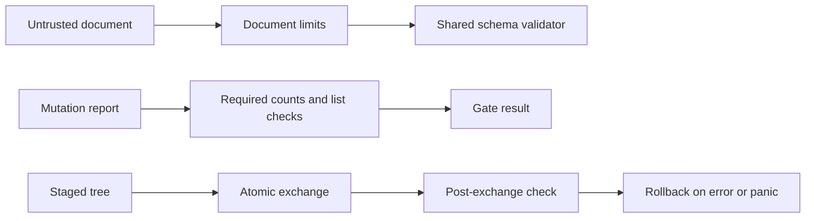

# Design 0010: Whole-port audit remediation

Issue: #617. This design extends design 0009 after review of the full port.
The audit records each milestone requirement and each related PR.

## Boundaries and reuse

The existing components own the fixes. No new package or dependency is needed.
Use standard JSON errors, number conversion, bounded readers, and deferred
cleanup. Keep `jsonschema`, `yaml.v3`, `go-gitdiff`, and `testscript`.
Do not replace these libraries with local parsers or validators.

The shared architecture checker has development branches but no release.
Adoption must preserve the four release platforms and the existing model rules.
The RAES adapter also remains a dependency; interfaces alone do not deliver it.

## Failure handling

The lint recipe captures the platform list before its loop. A failed list
must fail the target. Vulnerability checks run for every model platform.
Mutation report parsing checks required counts and their agreement with
the mutant lists. Missing or inconsistent evidence must fail the gate.

JSON ingestion distinguishes duplicate names from other syntax errors with
`errors.Is` and `jsontext.ErrDuplicateName`. Decimal and exponent forms must
fit the finite float range of the Python contract. An exponent must also
fit the document byte budget before a schema validator expands it.
Integer tokens retain their digits. Node and depth errors keep their order.

A pack read saturates its lookahead count instead of overflowing it.
Replacement installs a deferred rollback before it calls the check.
An unexpected panic rolls back before it propagates. A failed rollback
retains the original tree and returns the existing recovery error.
The staging writer retains its private, fresh-root precondition.

The executable check rejects group write access as well as other write
access. The command uses the caller's trusted PATH; it does not establish
trust in executable owners or their parent directories.

The command uses `exec.CommandContext` with a one-minute limit and a one-second
pipe wait limit. Output buffers stop at 8 MiB for stdout and 64 KiB for
stderr. A small bounded writer is needed because `os/exec` takes writers;
the standard library has a limited reader but no limited writer.
Timeout and output-limit failures use the existing bounded tool-failure path.

The GitHub client refuses empty JSON and discovery results at the configured
issue or label cap. It stops before writes. This preserves the existing `gh`
invocations without treating a truncated list as a complete inventory.

## Tests and evidence

Add regressions for each reproduced failure. Use real temporary trees for
transaction checks and fake commands for failure tests. Add hardlink and
byte-budget fuzz inputs. The audit records acceptance gaps separately from
implementation defects and from planned work.

| Threat | Control | Evidence |
| --- | --- | --- |
| A gate passes without evidence. | Check discovery failures and report counts. | Negative gate tests. |
| A short number crashes schema validation. | Check exponent and finite range at ingestion. | Ingestion and schema regression. |
| A defect leaves an unaccepted replacement installed. | Roll back during panic unwinding. | Real exchange and recovery tests. |
| A large byte limit silently drops content. | Saturate the lookahead count. | Maximum-integer regression. |
| A shared executable permits group modification. | Reject both group and other write bits. | Temporary executable tests. |

Libraries remain silent. Expected errors carry stable codes; command
boundaries own messages and status codes. Raw documents, credentials, and
panic values do not enter diagnostic messages.

## Verification

Run targeted tests locally, including regression proof and mutation tests.
Hosted CI runs the full repository checks. Keep issue 617 open until each
finding has a disposition and the required integration has approval.
