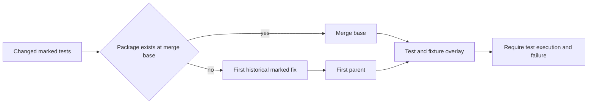

# Design 0011: Stabilize and integrate the Go stack

The integration PR carries the existing Go stack and its stabilization fixes
to `go-cutover`. It preserves source history with a merge commit. The maintainer
performs that merge after verification. Ordinary feature PRs still use squash.

## Regression proof across a stack

The target branch lacks packages that the stack adds. Applying their regression
tests to that target cannot compile. Compilation failure proves no defect.

The gate keeps the merge base for each package that exists there. For an absent
package, it searches commits reachable from HEAD but absent from the base.
It finds the first commit that marks each selected function as a regression test.
Its first parent supplies the code before that fix. The gate copies only current
tests and fixtures onto that parent, then requires the named test to fail.

Use Git for history and the existing Go syntax parser for test declarations.
No configured revision, success waiver, or network service selects the baseline.
A missing historical test, an invalid revision, a compile failure, a skipped test,
or a passing test fails the gate. Normal PRs retain their existing baseline.
Group tests by baseline and package so each historical tree serves related tests.

## Development workflow

The Go branch configures `go-cutover` as the base for normal issue workflows.
Go dependency updates also target this branch and use a non-release commit type.
The Python product remains on dev until the planned cutover. Scheduled jobs and
Dependabot still require their configuration on the default branch to activate.

This integration delivers the existing foundations. It does not implement the
remaining product commands or a substitute for the unavailable RAES Go API.
Those milestone issues retain their acceptance criteria. The shared architecture
checker still requires its first approved release before consumer adoption.

## Security and verification

| Boundary | Control | Evidence |
| --- | --- | --- |
| Git history to regression baseline | Select only an ancestor of HEAD before the marked fix. | Historical-repository tests. |
| Tests to historical implementation | Copy only tests and fixtures; require execution and failure. | Negative compile, pass, skip, and missing-history cases. |
| Integration to protected branch | Required checks and explicit maintainer merge. | Hosted checks and ruleset readback. |
| RAES semantics to pack tooling | Keep declarations; wait for the upstream implementation. | Existing import-boundary check. |

Run targeted gate tests locally. Hosted CI validates the complete combined tree,
including mutation, regression, conformance, content, security, and fuzz checks.

The combined mutation run also checks two error boundaries. Malformed milestone
JSON must retain its decoding error. An empty regression selection must succeed
without asking Git for an unused baseline, even if that lookup would fail.

The current dev content test also projects a realization concern through RAES.
Extend the existing Content interface with this operation, using published JSON
values and the two RAES projection options. Keep projection and status vocabulary
in RAES. Record the new imports in the operation map; add no local semantics.
