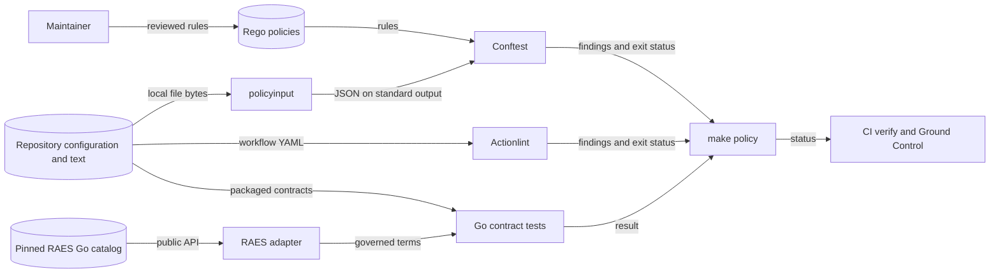

# Design 0012: Repository policy and contract alignment

## Architecture

`make policy` is the common CI and Ground Control entry point.
Conftest evaluates repository-owned Rego rules against a local JSON input.
Actionlint checks GitHub Actions syntax and expressions.
Both tools have exact versions in `mise.toml` and checksums in `mise.lock`.
Policies stay in this repository. The gate does not download policies.

`tools/policyinput` reads repository configuration and selected maintained text.
It uses `internal/strictyaml` for YAML and `go-toml/v2` for TOML.
JSON inputs must also pass the standard JSON syntax check.
Strict YAML decoding rejects duplicate keys in JSON objects.
The standard `mvdan.cc/sh/v3/syntax` parser extracts shell commands without executing them.
It writes the parsed documents, command arguments, and selected text as one JSON document.

The explicit filesystem keeps all reads inside the selected checkout, including symlink targets.
A single envelope joins structured input, maintained text, and parsed shell arguments.
Native Conftest file collection does not enforce that filesystem boundary or extract those arguments.
The collector therefore uses standard YAML, TOML, and shell parsers rather than a custom grammar.

It does not interpret policy, execute repository scripts, or read host secrets.
The command uses `internal/report`, `internal/outcome`, and `internal/terminal` for value-free errors and exit status.
Missing required inputs and malformed documents fail the gate.
Each Rego policy accepts compliant input and rejects a mutation.
The inventory maps the old checks to Rego, standard tools, or Go tests.

`internal/contractalignment` contains Go tests of the packaged contracts.
It uses the existing schema compiler and strict document decoder.
Its checks cover the RAES identity, provenance, and concept boundaries.
Behavioral tests drive the actual aggregate script and Makefile with fake commands.
They test failure propagation without a GitHub write.

`internal/raesadapter` is the sole importer of the public RAES Go module.
This change supplies only vocabulary access through `internal/raes`.
It loads the packaged upstream catalog through `contract/concept`.

Tests consume the two upstream offensive-behavior vocabularies without a local snapshot.
The verified module revision is `17bf4515bf12747af69c8598a2fc82d73e9651b9`.
Its public `contract/concept` package supplies `Load` and `Authority.Vocabulary`.
`go mod download` verified the module and metadata sums before implementation.

The remaining adapter operations stay in issue #643.
The model permits RAES imports only in this adapter component.

The Go module checksum and tidiness gates replace runtime Python dependency locks after cutover.
Documentation keeps Python, Sphinx, and its hash-locked requirements under ADR 0047.
Checks specific to the current Python product remain active until its removal in #582.
This migration does not change package versions, pack content, or release destinations.

## Systems security engineering

| Asset | Threat and boundary | Control | Verification |
| --- | --- | --- | --- |
| Merge decisions | A workflow grants excess token scope or omits a required job. | Rego checks permissions and aggregate membership. | Passing input and rejected mutations; aggregate script failure matrix. |
| Release integrity | Signing, verification, or attestation moves after publication. | Rego checks release identity, ordering, recovery, and non-destructive tag handling. | Each policy rejects a broken fixture. |
| Host and credentials | Repository input becomes a command or reads host files. | The collector uses fixed repository paths and an explicit filesystem. Rego evaluates data only. | Collector tests reject missing and malformed inputs; review checks the file list. |
| Scenario authority | A local vocabulary replaces RAES terms. | The sole adapter reads the real upstream catalog at an exact revision. | Real upstream vocabulary tests and a negative architecture fixture. |
| Public documentation | Maintainer records enter the public source or navigation. | Rego checks configuration, paths, and navigation from collected facts. | A public-root escape fails the policy test. |

Maintainers review repository code and policy.
The gate does not sandbox hostile code.
CI runs them on an isolated runner with a read-only token.
Policy changes still need maintainer review.
The gate emits file names and rule identifiers, without input values or credentials.

## Data flow

The repository-to-host boundary permits local reads of the selected checkout.
The RAES module-to-adapter boundary preserves upstream semantic ownership.
The policy-to-CI boundary carries only findings and exit status.
No data flow uploads repository input or publishes an artifact.
The existing C4 generator renders the three components from the model.
No deployment diagram changes because the gate runs in the existing CI runner.

## Decisions and references

ADR 0047 already selects Go and the sole RAES adapter.
ADRs 0004, 0015, 0017, 0018, 0019, 0020, and 0030 still govern their existing invariants.
This design changes the enforcement tools, not those decisions.

| Source | Version and section | Use |
| --- | --- | --- |
| https://www.conftest.dev/ | Conftest 0.71.1; Evaluating Policies and Testing/Verifying Policies | Rego evaluation and positive/negative tests. |
| https://www.conftest.dev/options/ | Conftest 0.71.1; Parser and Policy options | Explicit local input and policy directories. |
| https://www.openpolicyagent.org/docs/policy-testing | Rego v1; Parameterized tests and Data-driven tests | One passing and failing case per policy. |
| https://github.com/rhysd/actionlint/blob/v1.7.12/docs/checks.md | actionlint 1.7.12; Workflow syntax and expressions | Standard workflow validation. |
| https://www.openpolicyagent.org/docs/cicd | Rego v1; Configuration checks in CI | Local policy evaluation in the existing CI gate. |
| https://pkg.go.dev/mvdan.cc/sh/v3/syntax | 3.14.1; Parser and syntax nodes | Extract shell arguments without execution. |
| https://pkg.go.dev/github.com/pelletier/go-toml/v2 | 2.4.3; Unmarshal | Decode repository TOML without a custom grammar. |
| https://go.dev/ref/mod | Go 1.27; Authentication and go.sum files | Module integrity and exact dependency revisions. |

The document separates design explanation from the invariant reference and operating instructions.
Review checks technical terms, sentence length, purpose, and meaning against the maintained style guide.
Vale checks the changed documents; its result does not prove full STE compliance.
