# Experiment artifact set design

This design adds RAES experiment documents to the pack layout.
[ADR 0042](../decisions/adrs/0042-carry-raes-experiment-artifact-sets-in-packs.md)
records the decision. The
[preflight note](experiment-artifact-set-preflight.md) records the guardrails.

## Components

| Component | Responsibility |
| --- | --- |
| Discovery (`validation.py`) | Selects direct `experiments/` members by suffix from the safe inventory. |
| Document admission (`validation.py`) | Reads each member through `_pack_fs` limits. Admits tasks and capture specifications through `ExperimentTaskModel` and `ExperimentCaptureSpecModel`. Admits authoring inputs through `parse_experiment_spec`. |
| Reference resolution (`validation.py`) | Joins `task_ref`, `capture_spec_refs`, and `intended_scenario_ref` to pack documents by RAES identity and version. |
| Family checks (`validation.py`) | Admits the named SDL document through `admit_scenario_family`. Runs `validate_experiment_selection_against_family`, `ExpandedScenarioBindingTargetResolver.validate_selection`, and `validate_experiment_binding_targets` for scenario-plane bindings. |
| Snapshot (`_PackSnapshot`) | Retains the admitted artifact sets from the same validation pass. |
| Loader (`experiments.py`) | `load_pack_experiments` returns `PackExperiment` records, or raises `PackExperimentError` with the bounded diagnostics. |
| Request join (`experiments.py`) | `PackExperiment.compilation_request` derives input references from the pack documents. It adds the caller-supplied apparatus context and returns a RAES `TrialCompilationRequest`. |

A composed family from the trusted author lane is already an admitted
`ExpandedScenario`. The consumer lane denies imports, as before.

The family checks need no participant or apparatus manifest. The RAES trial
compiler checks participant targets, apparatus compatibility, capture offers,
and every requested combination. It needs caller-supplied apparatus context.

## Failure behavior

Each failure adds one stable code and a pack-relative path. No diagnostic
contains RAES exception text, authored values, or absolute paths. A pack with
any diagnostic returns no `PackExperiment`. Release and verification refuse it
through their existing static gates.

| Code | Condition |
| --- | --- |
| `experiment.spec-invalid` | The RAES loader rejects an authoring input. |
| `experiment.task-invalid` | A task is malformed or fails its RAES model. |
| `experiment.capture-invalid` | A capture specification is malformed or fails its RAES model. |
| `experiment.*-duplicate` | Two documents of one kind share an identity and version. |
| `experiment.task-unresolved`, `experiment.capture-unresolved` | A reference matches no pack document. |
| `experiment.task-ambiguous`, `experiment.capture-ambiguous` | A reference without a version matches more than one document, or two capture references select one capture id. |
| `experiment.scenario-unresolved` | The family reference is absent, is not an id-only `scenario` reference, or matches no SDL document name. |
| `experiment.scenario-ambiguous` | More than one SDL document has the referenced name. |
| `experiment.family-invalid` | RAES does not admit the SDL document as a family. |
| `experiment.selection-invalid` | A selection policy fails the RAES family check. |
| `experiment.treatment-invalid` | A typed treatment fails the RAES target check, including a stale family digest. |
| `experiment.binding-invalid` | A scenario-plane binding fails the RAES target check. |

## Systems security engineering

| Asset | Protection need |
| --- | --- |
| Treatment intent and condition joins | Integrity |
| Family digest pins and prompt commitments | Integrity |
| Restricted prompt content | Confidentiality; the pack carries commitments only |
| Consumer process | Availability |

| Threat | Boundary | Control | Verification |
| --- | --- | --- | --- |
| Oversized or deeply nested documents exhaust the consumer. | Pack bytes to validator | Bounded member reads, `PackValidationLimits`, and the RAES 64 KiB loader bound. | Oversized and malformed document tests. |
| YAML aliases or duplicate keys change meaning. | Pack bytes to validator | The RAES loader and the strict JSON reader reject both. | Duplicate-key tests. |
| A link or traversal reads outside the pack. | Pack bytes to validator | Descriptor-anchored `_pack_fs` reads. | Existing filesystem tests. |
| A duplicate identity substitutes a document. | Validator | Duplicate and ambiguity diagnostics. | Duplicate and ambiguity tests. |
| A stale or forged family pin selects other content. | Validator to RAES | The RAES target resolver compares the canonical family digest. | Stale-pin test. |
| An invalid combination reaches a trial. | Caller to RAES compiler | The RAES compiler rejects the whole design. | Invalid-combination test. |
| A diagnostic discloses authored data. | Validator to caller | Stable codes only. | Diagnostic-content tests. |
| A participant export reveals the experiment. | Release views | Existing artifact boundaries and the staged leak scan. | Existing release tests. |

Residual risk: Python callers can edit a returned model. They must reload the
pack after an edit. Static validity does not prove trial admission or backend
execution.

## Data flow

```mermaid
flowchart LR
    author[Pack author]
    caller[Consumer]
    pack[(Pack files)]
    subgraph untrusted[Untrusted pack boundary]
        inventory[Discovery and bounded reads]
        admit[RAES document admission]
        resolve[Reference resolution]
        family[RAES family checks]
    end
    snapshot[(Validated snapshot)]
    join[Request join]
    compiler[RAES trial compiler]
    plan[(Admitted trial plan)]
    author -->|SDL and experiment documents| pack
    pack -->|member bytes| inventory
    inventory -->|document text| admit
    admit -->|typed documents| resolve
    resolve -->|experiment and family| family
    family -->|admitted artifact sets| snapshot
    snapshot -->|PackExperiment| join
    caller -->|apparatus context| join
    join -->|TrialCompilationRequest| compiler
    compiler -->|plan or diagnostics| plan
```

The diagram also shows component dependencies. No service, store, or
deployment component is added, so no deployment diagram is necessary.

## Supporting artifacts

- Policy as code: `tests/test_pack_experiments.py` guards the layout rules,
  the diagnostics, and the absence of a local experiment schema.
  `tests/test_raes_identity.py` guards the RAES minimum version, and
  `tests/test_dependency_pinning.py` guards the hash-locked CI version.
- Architecture as code: the RAES contract models and the typed `PackExperiment`
  record define the interfaces. No infrastructure definition changes.
- ADR: [ADR 0042](../decisions/adrs/0042-carry-raes-experiment-artifact-sets-in-packs.md).
- Layout contract: `contract/pack-layout.md` version 8.

## Dependency tuple

| Component | Version |
| --- | --- |
| `raes` | `>=9.2.0` (minimum version, [ADR 0043](../decisions/adrs/0043-require-a-minimum-raes-version.md)); CI lock 9.2.0 |
| CPython | `>=3.14,<3.15` |
| Layout contract | 8 |
| `raes-env-packs` | The release that contains this change |

## References

- [RAES typed factorial example](https://github.com/OpenRAE/rae/blob/v9.2.0/docs/explain/reference/typed-factorial-example.md),
  RAES 9.2.0, sections "Declare the effects" and "Compile and realize":
  treatment declarations, family pins, and whole-design rejection.
- [RAES scenario family admission](https://github.com/OpenRAE/rae/blob/v9.2.0/docs/explain/scenario-family-admission.md),
  RAES 9.2.0, sections "Architecture" and "Security and verification":
  admission of an import-free family.
- [RAES ADR-074](https://github.com/OpenRAE/rae/blob/v9.2.0/docs/decisions/adrs/adr-074-experiment-authoring-input-contract-boundary.md),
  RAES 9.2.0, section "Context": the authoring input and the `*.exp.yaml`
  convention.
- [OWASP Input Validation Cheat Sheet](https://cheatsheetseries.owasp.org/cheatsheets/Input_Validation_Cheat_Sheet.html),
  current edition, section "Input Validation Strategies": syntactic and
  semantic checks at a trust boundary.
- [OWASP Threat Modeling Cheat Sheet](https://cheatsheetseries.owasp.org/cheatsheets/Threat_Modeling_Cheat_Sheet.html),
  current edition, section "Addressing Each Question": DFD elements and STRIDE.
- [NIST SP 800-160 Volume 1 Revision 1](https://csrc.nist.gov/pubs/sp/800/160/v1/r1/final),
  2022, systems security engineering: assets, protection needs, and verification.
- [ASD-STE100](https://www.asd-ste100.org/), Issue 9, sections 1, 5, and 6:
  writing rules for this document.
