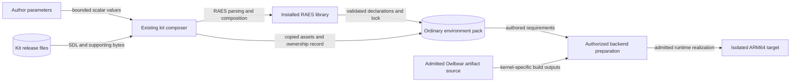

# Owlbear protected-target kit design

Issue: #540. The release uses the existing infrastructure-kit contract.

## Components and contracts

Publish `infrastructure.owlbear-protected-target` version `1.0.0` under `kits/`.
Use the `security-operations` concern.
The module exports one ARM64 Linux compute node named `target`.
Its OS is Ubuntu 24.04.
Its planning estimate is two CPU cores, 4 GiB RAM, and 8 GiB storage.
The compute substrate remains open.
A backend must admit the required kernel access before realization.
No host privileges, host mounts, network listeners, or cloud services are granted.

The source reference is Owlbear commit `fa4497f3273517611e2d62f5fb32c620a00a9681`.
Its README identifies the prototype as version 2.3.0.
The reference deployment uses ARM64 Linux and kernel 6.17.
The kit does not assert compatibility with other kernel builds.

Four exported content declarations require the kernel module, daemon, game, and signatures.
Each declaration uses the existing RAES `Source` selector with the reference revision.
These selectors identify required build outputs, not published binary releases.
Their immutable binary identities remain unresolved until authorized artifact admission.
The daemon includes the upstream eBPF skeletons.
No separate eBPF runtime object is invented.
The release includes no Owlbear executable or upstream source bytes.
Its provenance document records the upstream revision, license, and artifact paths.

The `daemon_active_state` parameter accepts `active` or `inactive`.
It changes the typed RAES service-manager unit state.
The unit has a portable unit ID and no fixed native unit name or manager.
Backend preparation supplies the unit mapping and process target.
The upstream project does not supply that service-manager wrapper.
Inactive daemon state does not establish an unprotected kernel.
Active daemon state does not establish effective enforcement.
The kit supplies no new runtime configuration language or lifecycle script.

`deployment_profile` and `service_label` retain the collection's naming convention.
Profile labels do not change resource allocation.
The benign seed inventory describes the reference workload, component paths, and default daemon state.
Copied seed assets describe defaults; module parameters do not render those assets.
Connections to other kits belong at the consuming pack root.

## Data flows and trust boundaries

Authoring stops at the ordinary pack boundary.
The composer reads only admitted local files.
It performs no artifact download, service start, or kernel operation.
Artifact admission and privileged execution cross a separate backend authorization boundary.
The upstream cloud platform receives no data from kit composition.

## Security decisions

| Asset or threat | Boundary and control | Verification |
| --- | --- | --- |
| Modified kit bytes | Existing release admission verifies the semantic parent, file hashes, sizes, and set digest. | Load the release, then reject a modified member. |
| Untrusted artifact selection | RAES owns source selection; binary digests and trust remain unresolved until authorized admission. | Inspect composed source selectors and component inventory. |
| Kernel compromise or unsuitable host | Declare ARM64 Linux; keep substrate selection open and document required kernel capabilities. | Compile declarations and check substrate planning. No privileged test runs. |
| Accidental network exposure | Declare no listener, endpoint, external telemetry destination, credential, or cloud resource. | Inspect parsed runtime and composed content. |
| Misleading protection claim | Separate daemon state, kernel availability, and enforcement effectiveness. | Assert typed state variation; retain runtime limits in integration material. |
| Asset collision or author edit loss | Reuse transactional proposal/apply and existing ownership checks. | Materialize the kit into an ordinary pack and validate its lock and artifact bindings. |

Residual risk remains in the admitted binaries, kernel build, privileges, and backend implementation.
Static composition tests cannot establish runtime protection or readiness.

## Existing architecture and policy

Reuse `kits.load_kit_release`, `KitSource`, `propose_add`, and `apply_proposal`.
Reuse RAES parsing, canonical SDL digests, associated-artifact manifests, compilation, and planning.
Do not add a parser, resolver, schema, runtime adapter, or publication path.
The existing wheel and source-distribution mappings include the new release.
Existing admission and redistribution tests remain the executable policy.
Update collection counts and documentation to include the new release.

ADRs 0009, 0035, 0036, and 0041 already authorize this architecture.
No decision changes, new infrastructure template, or deployment diagram are required.
The module and existing schema provide the architecture as code.
The data-flow diagram also identifies the components and their interfaces.

## Sources and document review

- Owlbear README, `daemon/Makefile`, `daemon/main.c`, and LICENSE at the reference revision:
  <https://github.com/Brad-Edwards/owlbear/tree/fa4497f3273517611e2d62f5fb32c620a00a9681>.
- RAES 10.0.0: installed `Source`, `RuntimeSoftwareComponent`, `ServiceManagerUnit`, and realization models.
  Public authority: <https://github.com/OpenRAE/rae>.
- Linux kernel documentation, LSM BPF Programs, structure and loading:
  <https://docs.kernel.org/bpf/prog_lsm.html>.
- NIST SP 800-160 Volume 1 Revision 1, systems security engineering:
  <https://csrc.nist.gov/pubs/sp/800/160/v1/r1/final>.
- ASD-STE100 Issue 9, Part 1 writing rules and Part 2 dictionary:
  <https://www.asd-ste100.org/assets/files/ASD-STE100_ISSUE9.pdf>.

Review sentences for length, active voice, consistent technical nouns, and approved word use.
Keep architecture facts here, implementation steps in the issue plan, and author procedures with the release.
