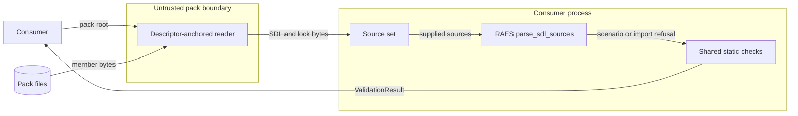
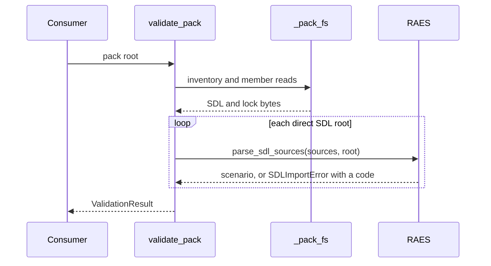

# Pack-local consumer validation design

This design lets the consumer check admit packs made with `raes-pack-kit add`.
[ADR 0046](../decisions/adrs/0046-admit-pinned-local-imports-through-raes-supplied-sources.md)
records the decision. The
[preflight note](pack-local-consumer-validation-preflight.md) records the guardrails.

## Components

| Component | Responsibility |
| --- | --- |
| Source set (`validation.py`) | Selects each `*.sdl.yaml` and `raes.lock.json` member below `sdl/` from the safe inventory. Reads each member one time through `_pack_fs`. Enforces the total byte limit. |
| Consumer parse (`validation.py`) | Calls RAES `parse_sdl_sources()` for one direct root. Maps RAES failures to stable codes. Parses a materialized root with content-only `parse_sdl()`. |
| Shared static checks (`validation.py`) | Receive the RAES scenario. Content-set, concept-binding, and experiment checks do not change. |
| Artifact resolution (`digest.py`) | `resolve_pack_artifact()` uses the same source set and consumer parse for its parent candidates. It reuses the bytes of a selected parent document (ADR 0033). |
| Lock writer (`kits.py`) | Writes one `raes.lock.json` for each directory. Merges the RAES lock records of each SDL document in that directory. Refuses two records that disagree. |
| RAES | Owns import normalization, pins, lock agreement, composition, and semantic validation. |

## Failure behavior

Each failure adds one stable code and a pack-relative path.
No diagnostic contains RAES message text, authored values, or absolute paths.

| Code | Condition |
| --- | --- |
| `sdl.imports-denied` | RAES raises `SDLImportError`. The path is the importing document. The field is the import pointer. |
| `sdl.invalid` | RAES raises another `SDLError`. |
| `sdl.invalid-utf8` | A root document is not UTF-8. |
| `resource.sdl-limit` | A member or the source set exceeds its byte limit. |

## Systems security engineering

| Asset | Protection need |
| --- | --- |
| Consumer process and host | Integrity and availability |
| Composed scenario | Integrity |
| Host environment and credentials | Confidentiality |

| Threat | Boundary | Control | Verification |
| --- | --- | --- | --- |
| An import fetches from a registry or the network. | Validator to RAES | `parse_sdl_sources()` refuses each non-`local:` source before dispatch. | Registry and `locked:` tests with network access trapped. |
| A pack trust file enables a registry. | Pack bytes to RAES | The source set has no trust file. RAES reads no trust file. | Hostile trust-file test. |
| Module bytes change after the author pinned them. | Pack bytes to RAES | RAES compares each pin and lock record with the supplied bytes. | Changed-module test. |
| An unpinned or unlocked import enters a scenario. | Validator to RAES | RAES requires a pin and one agreeing lock record at each depth. | Unpinned and unlocked tests. |
| A link or traversal reads outside the pack. | Pack bytes to validator | Descriptor-anchored `_pack_fs` reads. RAES resolves imports inside the source set. | Existing filesystem tests and an escape test. |
| A large source set exhausts the consumer. | Pack bytes to validator | Member and total byte limits. RAES composition limits. | Limit test. |
| A diagnostic discloses authored data. | Validator to caller | Stable codes and pack-relative paths only. | Diagnostic-content tests. |

Residual risk: a pin and a lock record prove consistency, not trust.
The caller must stage the pack immutably and promote the same bytes.

## Data flow

## Sequence

