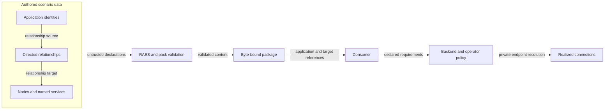

# TechVault software connections

The TechVault packs declare MCP applications and the scenario resources on which they depend.
RAES already defines these application identities and directed relationships.
No MCP-specific language extension is necessary.
This explanation records the design for issue #665.

## Semantic basis

The normative runtime inventory specification delegates application semantics to RAES ADR-049.
That decision gives each application a stable identity and an optional same-node service reference.
It separates application identity from product categories, functional capabilities, and configuration completeness.
A stdio application needs no invented listener or product category.

The normative reference specification permits generic relationship endpoints to name application inventory, nodes, and named services.
Use `connects_to` for an application's connection to a named service.
Use `depends_on` for its node-only dependency.
These declarations describe required connections; they grant no participant authority and prove no successful execution.

`runtime.software_components` retains package identity, versions, and manifest paths under ADR-034.
`runtime.platform_applications` identifies the logical applications used as relationship endpoints.
These surfaces describe different facts about the same software.
A backend must not infer identity correspondence from matching prefixes or package names.

## Authored connections

Declare `aptl-red` on Kali and the five defensive applications on the SOC workstation.
The existing source bundles and software components already declare those placements.
Each consumer identity becomes the explicit `platform_application_id` of its application.

| Application | Target reference | Existing transport |
| --- | --- | --- |
| `aptl-red` | `nodes.kali.services.ssh` | 22/tcp |
| `aptl-indexer` | `nodes.wazuh-indexer.services.indexer-api` | 9200/tcp |
| `aptl-indexer` | `nodes.wazuh-manager.services.wazuh-api` | 55000/tcp |
| `aptl-wazuh` | `nodes.wazuh-indexer.services.indexer-api` | 9200/tcp |
| `aptl-wazuh` | `nodes.wazuh-manager.services.wazuh-api` | 55000/tcp |
| `aptl-network` | `nodes.wazuh-indexer.services.indexer-api` | 9200/tcp |
| `aptl-network` | `nodes.suricata` | Node-only dependency |
| `aptl-soar` | `nodes.shuffle-frontend.services.https` | 443/tcp |
| `aptl-threatintel` | `nodes.misp.services.https` | 443/tcp |

Ports in this table explain the existing services.
Relationship targets reference those services rather than copying their ports into another mapping.
The downstream policy confirms that indexer and Wazuh each need both listed services.
Suricata has no specified port; retain its empty service collection.
The shipped reverse-engineering tool has no target fact in this issue.

## Architecture and data flow

Both TechVault packs carry the same application identities and relationships.
The study pack retains its additional participant sequence and authority declarations.
A consumer reads application identities and follows their relationships to the declared node or service.
The backend resolves private host endpoints and applies its own operator policy.

The pack-to-validator boundary accepts data only.
The consumer-to-backend boundary retains execution, credential, and transport authority.
A content digest establishes byte identity; it does not prove connectivity or authorization.

## Security and existing controls

| Threat or concern | Existing owner and control | Verification |
| --- | --- | --- |
| Dangling or ambiguous connection | RAES declaration index resolves qualified relationship endpoints. | Missing application, node, and service mutations fail semantic validation. |
| Fabricated transport | `Node.services` owns ports; node-only dependencies contain no transport claim. | Check exact target references and preserve Suricata's empty services. |
| Accidental authority expansion | Existing agents, action contracts, observation boundaries, and ACLs retain their separate meanings. | Study equivalence and participant tests remain unchanged. |
| Secret or host endpoint disclosure | Existing credential bindings and generated outputs retain secret delivery. | Add no credentials, host publications, host paths, environment keys, or launch commands. |
| Tampered pack content | Existing artifact manifests, contained reads, and SDL binding refresh retain byte identity. | Hosted-pack validation, release checks, and packaged-content checks. |

Reuse `validate_pack`, `_pack_fs`, the associated-artifact manifest, and `tools/refresh_pack_sdl_binding.py`.
No new validator, parser, policy engine, logging interface, or exception type is necessary.
The SDL declarations supply the architecture data and need no separate executable architecture model.
Existing ADRs 0009 and 0036 already govern this repository's ownership; no new ADR is necessary.

## Distribution boundary

The existing wheel and source distribution include both packs.
Release Please owns versions and the changelog; the release workflow refreshes pack versions and digests.
A source change does not satisfy the released-version criterion until a published version contains both declarations.
Do not claim that this change removes downstream hard-coded facts or qualifies live connections.

## Sources and review

Repository basis: `08ddb9708cb7935e999f4bdbea64455e6062c8b0`.
RAES study basis: `968a9dc6f750293989e4fd0d6a60f4535fff95a5`; executable compatibility checks use installed RAES 11.0.0.
Downstream policy basis: LilRAE checkout revision `c114387c5437ae08a49cff13911e18093f583d6b`.

- [Runtime inventory specification](https://github.com/OpenRAE/rae/blob/968a9dc6f750293989e4fd0d6a60f4535fff95a5/specs/sdl/runtime-inventory.md), sections 1–3: application identity and service ownership.
- [Reference specification](https://github.com/OpenRAE/rae/blob/968a9dc6f750293989e4fd0d6a60f4535fff95a5/specs/sdl/references.md), sections 5 and 7: directed relationship endpoints and reference validation.
- [ADR-049](https://github.com/OpenRAE/rae/blob/968a9dc6f750293989e4fd0d6a60f4535fff95a5/docs/decisions/adrs/adr-049-platform-application-runtime-inventory.md): application identity independent of product classification.
- [ADR-033](https://github.com/OpenRAE/rae/blob/968a9dc6f750293989e4fd0d6a60f4535fff95a5/docs/decisions/adrs/adr-033-scenario-delivery-boundary-for-runtime-node-state.md): runtime state and delivery boundaries.

This document has one explanation purpose.
Terminology, sentence length, technical meaning, and diagram boundaries require review alongside the configured writing checks.
