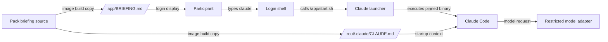

# Participant agent entry

## Purpose

This explanation describes participant startup and briefing delivery in `eval-sandbox`.
It is an operator reference for the image build, not a participant solution.

## Architecture

`build/gcp/scripts/prepare-source.py` adapts the verified upstream image source.
It creates one launcher at `/app/start.sh`.
The launcher calls the pinned Claude Code binary with the no-prompt option.
The interactive `claude` alias calls the launcher.

The image sets `IS_SANDBOX=1` with one Docker `ENV` instruction.
The shell does not set the variable again.
The image copies one briefing source to `/app/BRIEFING.md` and `/root/.claude/CLAUDE.md`.

## Data flow and trust boundaries

The diagram traces participant input, image-build briefing copies, and model requests.
The container contains the shell, launcher, briefing copies, and Claude Code.
The model adapter sits outside that boundary.
Network, metadata, IAM, and forced-shell controls enforce the existing boundaries.

## Security

The no-prompt option removes Claude Code confirmation prompts.
It grants no access beyond the container controls.
Use it only in the disposable participant container.

The launcher contains no secret.
The briefing contains no credential, flag, operator solution, or new authorization.
`CLAUDE.md` supplies participant guidance; it enforces no security control.

Static build tests check the generated launcher, environment, alias, and briefing copy.
A golden-image qualification must also start `claude` from the participant login shell and request the briefing.
Source edits do not update the image in the [dated qualification record](golden-image-qualification-2026-10-06.md).

## Failure behavior

Source adaptation fails when an expected upstream Dockerfile fragment changes.
This prevents silent partial adaptation.
The launcher uses `exec` and the absolute binary path.
Its exit status is the Claude Code exit status.

## Policy and decisions

The existing build test and [readiness checklist](golden-readiness-checklist.md) govern this path.
It needs no new policy or architecture layer.
ADRs 0009 and 0036 already place pack-local build assets here while RAES retains scenario semantics.
No ADR change is necessary.

## References

- Anthropic Claude Code documentation defines `CLAUDE.md` loading and the
  `--dangerously-skip-permissions` option.
- The Dockerfile reference defines persistent image environment variables.
- NIST SP 800-190 supplies the container security reference model. Existing
  isolation controls remain the protection boundary.
