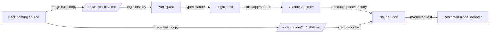

# Participant agent entry

## Purpose

This design defines how a participant starts Claude Code in `eval-sandbox`.
It also defines how Claude Code receives the participant briefing.

## Architecture

`prepare-source.py` adapts the verified upstream image source. It creates one
launcher at `/app/start.sh`. The launcher calls the pinned Claude Code binary
with the no-prompt option. The interactive `claude` alias calls the launcher.

The image sets `IS_SANDBOX=1` with one Docker `ENV` instruction. The shell does
not set the variable again. The image copies one briefing source to both
`/app/BRIEFING.md` and `/root/.claude/CLAUDE.md`.

## Data flow and trust boundaries

The container boundary contains the shell, launcher, briefing copies, and
Claude Code. The model adapter is outside that boundary. Existing network,
metadata, IAM, and forced-shell controls remain authoritative.

## Security

The no-prompt option removes Claude Code confirmation prompts. It does not
grant access outside the container controls. The option is acceptable only in
the disposable participant container.

The launcher contains no secret. The briefing contains no credential, flag,
operator solution, or new authorization. `CLAUDE.md` is participant guidance,
not a security control.

Static build tests verify the generated launcher, environment, alias, and
briefing copy. A golden-image qualification must also start `claude` from the
participant login shell and request the briefing.

## Failure behavior

Source adaptation fails when an expected upstream Dockerfile fragment changes.
This prevents a silent partial adaptation. The launcher uses `exec` and the
absolute binary path, so its exit status is the Claude Code exit status.

## Policy and decisions

No new policy-as-code or architecture-as-code layer is required. The existing
pack build test and golden readiness checklist govern this path. No ADR change
is required because ADR 0009 and ADR 0036 already place pack-local build assets
inside this repository while RAES retains scenario semantics.

## References

- Anthropic Claude Code documentation defines `CLAUDE.md` loading and the
  `--dangerously-skip-permissions` option.
- The Dockerfile reference defines persistent image environment variables.
- NIST SP 800-190 supplies the container security reference model. Existing
  isolation controls remain the protection boundary.
